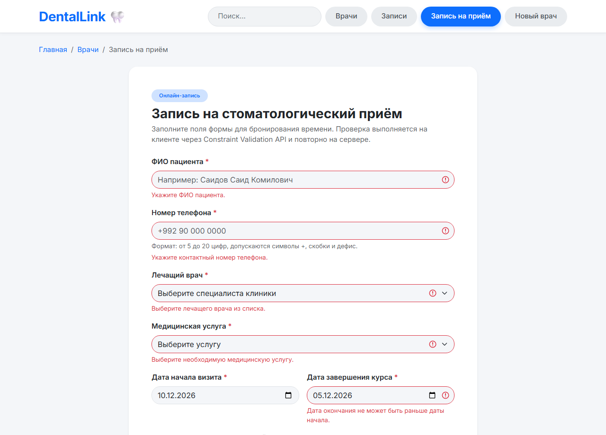
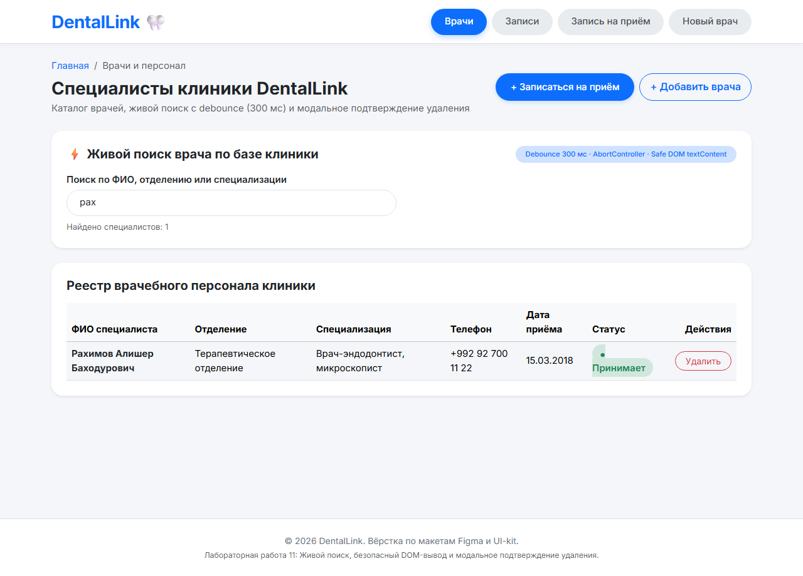
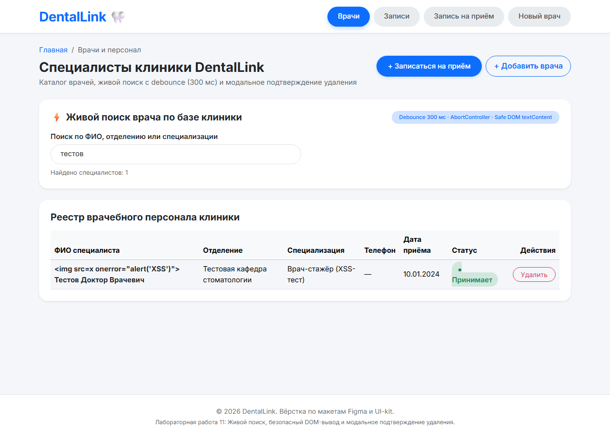
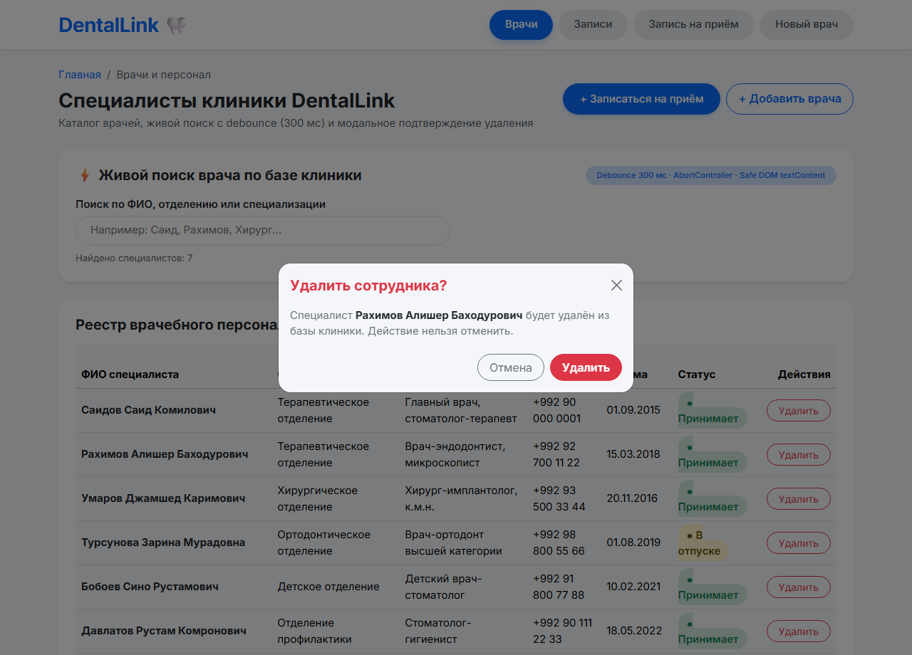

# DentalLink 🦷

[[Русский](README.md)] | Тоҷикӣ

**DentalLink** — специализированная веб-система для онлайн-записи пациентов и управления расписанием приёмов в стоматологической клинике.

---

## 📌 Описание и назначение проекта

Система разработана для оптимизации процесса записи пациентов к стоматологам одной клиники. Сервис позволяет пациентам удобно выбирать врача, услугу и свободное время онлайн, а клинике — эффективно управлять графиком работы специалистов, предотвращать накладки (double-booking) и минимизировать неявки с помощью автоматических напоминаний в Telegram.

---

## 🚀 Основной функционал

### 1. Для пациентов
- **Выбор услуги и врача**: каталог направлений (стоматолог, терапия, ортопедия, ортодонтия, хирургия, имплантация, детская стоматология, гигиена) с информацией о врачах, опыте и стоимости услуг.
- **Интерактивное расписание**: просмотр свободных слотов в реальном времени.
- **Быстрая онлайн-запись**: заявка по имени и номеру телефона. Учётной записи и пароля у пациента нет.
- **Telegram-уведомления**: мгновенное подтверждение записи и автоматические напоминания (за 24 часа и за 2 часа до приёма).
- **Свои записи**: просмотр, отмена и перенос по тому же номеру телефона, без входа в систему.

### 2. Для врачей
- **Персональный график**: просмотр расписания на день, неделю или месяц.
- **Информация о пациенте**: причина обращения, контакты, история предыдущих визитов.
- **Статусы приёма**: «Подтверждена», «Прибыл», «На приёме», «Завершён», «Отменена», «Не явился».

### 3. Для администратора клиники
- **Сетка расписания (Timeline / Календарь)**: единое расписание по всем кабинетам, креслам и врачам.
- **Ручное управление записями**: создание, перенос или отмена записей (включая запись пациентов по телефону).
- **Справочники**: управление врачами, графиками смен, услугами, длительностью процедур и ценами.
- **База пациентов (CRM)**: поиск пациентов, контактные данные, история посещений и комментарии.

---

## 🛠 Технологический стек

- **Backend**: C# (.NET 10 / ASP.NET Core Web API)
  - Архитектура: Clean Architecture (Domain, Application, Infrastructure, Api)
  - ORM: Entity Framework Core
  - Аутентификация: JWT / ASP.NET Identity только для персонала и врачей
  - Документация API: OpenAPI / Swagger
- **Frontend**: React SPA на Vite (TypeScript, React Router, Tailwind CSS / shadcn/ui)
  - Языки интерфейса: русский, тоҷикӣ, English
  - Шаг сетки расписания: 30 минут
- **База данных**: PostgreSQL
- **Кэширование и распределённые блокировки**: Redis (для предотвращения одновременного бронирования одного слота)
- **Уведомления**: Telegram Bot API
- **Оплата**: оплата производится на месте в клинике (без онлайн-эквайринга на первом этапе)

---

## 📂 Документация и структура проекта

```text
DentalLink/
├── database/                       # Физическая модель базы данных
│   ├── schema.sql                  # Скрипт создания таблиц, связей, индексов (PostgreSQL)
│   ├── seed.sql                    # Эталонные демонстрационные данные
│   └── queries.sql                 # Контрольные аналитические SQL-запросы (6 сценариев)
├── docs/                           # Проектная документация (Лабораторные 1–8)
│   ├── 01-domain-analysis.md       # Анализ предметной области, акторы, процессы, глоссарий
│   ├── 02-comparison-matrix.md     # Сравнительный анализ аналогов и проектные решения
│   ├── 03-short-spec.md            # Краткое ТЗ, MoSCoW, User Stories, НФТ
│   ├── 04-behavior/
│   │   ├── use-case.puml           # Диаграмма вариантов использования (UML Use Case)
│   │   ├── activity.puml           # Жизненный цикл записи на приём (UML Activity)
│   │   └── sequence.puml           # Удержание слота и бронирование (UML Sequence)
│   ├── 05-structure/
│   │   ├── class.puml              # Доменная модель Clean Architecture (UML Class)
│   │   └── component.puml          # Компонентная структура системы (UML Component)
│   ├── 06-logical-model.md         # Логическая модель данных, нормализация (3НФ), словари
│   ├── 06-er-diagram.puml          # Реляционная схема базы данных (ER-диаграмма)
│   ├── 07-deployment.puml          # Диаграмма физического развёртывания (UML Deployment)
│   ├── 07-screens/                 # Скриншоты верификации схемы и запросов в СУБД
│   └── 08-technical-specification.md # Полное техническое задание по мотивам ГОСТ 34.602 (РК-1)
├── backend/                        # ASP.NET Core (.NET 10) Clean Architecture
│   └── DentalLink.API/
└── README.md
```

---

## 🗺 План разработки (Roadmap)

- [x] Определение бизнес-требований и ключевого стека технологий (Лаб. 1–3)
- [x] UML-моделирование поведения и структуры системы (Лаб. 4–5)
- [x] Проектирование логической и физической схемы реляционной БД в 3НФ (Лаб. 6–7)
- [x] Разработка полного технического задания по ГОСТ 34.602 и рубежный контроль РК-1 (Лаб. 8)
- [x] UX/UI-проектирование в Figma (Лаб. 9)
- [x] Статическая вёрстка по макету: семантический HTML5, Bootstrap 5.3, CSS Grid, доступность (Лаб. 10)
- [x] Клиентская логика и JavaScript: валидация Constraint Validation API, живой поиск, XSS-защита, модальное окно Bootstrap (Лаб. 11)
- [ ] Шаблонизация и интеграция с бэкендом (Лаб. 12)
- [ ] Разработка серверного REST API на .NET 10, Redis Lock и интеграция с Telegram Bot (Дни 12–14)
- [ ] Комплексное тестирование системы (День 15)
- [ ] Развёртывание на VDS в Docker Compose, HTTPS и защита РК-2 (День 16)

---

## 📊 Таблица «Что сделано»

| Лабораторная работа | Тема | Результат и артефакты | Тег в Git |
|---|---|---|---|
| Лаб. 1–8 | Анализ предметной области, UML, БД (3НФ), ТЗ | `docs/01-08`, `database/` | `lab-06`, `lab-08` |
| Лаб. 9 | UI/UX дизайн в Figma: UI-kit, макеты экранов и прототип | `docs/09-design/` | `lab-09` |
| Лаб. 10 | FRONTEND (1): Статическая вёрстка по макету Figma (HTML5, Bootstrap 5.3, CSS Grid) | `public/static/*.html`, `public/assets/css/app.css`, `docs/10-screens/` | `lab-10` |
| Лаб. 11 | FRONTEND (2): JavaScript — валидация форм, живой поиск, XSS-защита, модальное окно | `public/assets/js/app.js`, `public/api/doctors/`, `public/static/*.html`, `docs/11-screens/` | `lab-11` |

---

## ⚡ Лабораторная работа 11. FRONTEND (2): JavaScript — валидация, живой поиск, модальное окно

В рамках лабораторной работы № 11 к статической вёрстке стоматологической информационной системы **DentalLink** добавлена полноценная клиентская логика на «чистом» ванильном JavaScript стандарта **ES2020+** (без применения сторонних JS-библиотек и фреймворков, в виде чистого ES-модуля).

### 🎯 Реализованный функционал

1. **Клиентская валидация форм через Constraint Validation API**:
   - Форма онлайн-записи на стоматологический приём (`public/static/appointment-form.html` и форма в `booking.html`) снабжена атрибутом `novalidate`, отключающим нативные браузерные всплывающие подсказки.
   - Более 4 проверяемых полей с различными типами HTML5-ограничений:
     - `patient_name` (ФИО пациента): `required`, `minlength="3"`, `maxlength="60"`.
     - `patient_phone` (Телефон): `required`, `type="tel"`, регулярное выражение `pattern="[0-9+\(\)\s\-]{5,20}"`.
     - `doctor_id` / `service_type`: выпадающие списки `required`.
     - `start_date` / `end_date`: `type="date"`, `required`.
     - `notes` (Жалобы): `<textarea>`, ограничение длины `maxlength="255"`.
   - **Собственное бизнес-правило валидации на два поля** (`checkAppointmentDates`): дата окончания курса лечения не может быть раньше даты начала. Перед проверкой вызывается `end.setCustomValidity('')`, предотвращая «залипание» ошибки.
   - **Событийная модель и делегирование**:
     - Событие `focusout` делегировано на уровне `<form>` — поле валидируется в момент ухода фокуса;
     - Событие `input` мгновенно снимает ошибку и убирает класс `is-invalid`, как только пользователь исправил значение;
     - Событие `submit` проводит полную проверку всех полей, отменяет отправку при ошибках (`event.preventDefault()`) и переводит фокус на первое ошибочное поле (`firstInvalid.focus()`).
   - Сообщения об ошибках сформулированы на русском языке и связаны с полями через `aria-describedby` для экранных читалок (доступность a11y).
   - Для сравнения подготовлена страница `public/static/doctor-form.html` (`employee-form.html`), где нарочно оставлена встроенная нативная валидация HTML5 («пузыри» браузера).

2. **Заглушка серверного API на PHP 8.2 (`public/api/doctors/index.php`)**:
   - Строгая типизация (`declare(strict_types=1)`), заголовки `Content-Type: application/json; charset=utf-8`.
   - Содержит 7 записей врачей-стоматологов с реальными атрибутами (ФИО, отделение, специализация, телефон, дата найма, статус).
   - Включает специальную запись для тестирования безопасности:
     `['id' => 7, 'full_name' => ' Тестов Доктор Врачевич', ...]`
   - Фильтрация по параметру `$_GET['q']` реализована с учётом регистра многобайтовой функцией `mb_strtolower` (любые запросы строчными буквами, например «рах» или «саид», находят совпадения).

3. **Интерактивный живой поиск (Live Search)**:
   - Подключён на странице каталога врачей `public/static/doctors.html` (`#doctor-search`, `#doctors-tbody`).
   - **Debounce 300 мс**: при быстром непрерывном наборе символов уходит всего один итоговый HTTP-запрос.
   - **AbortController**: отменяет предыдущий незавершённый запрос при поступлении нового ввода.
   - **Обработка статусов сети**: проверка `response.ok` (выбрасывает ошибку при кодах 404/500, так как `fetch` не считает их сетевыми исключениями).
   - Вывод статуса поиска в элемент с `aria-live="polite"` («Поиск…», «Найдено специалистов: N»).
   - **Безопасность (XSS)**: создание элементов таблицы через `document.createElement()` и вставка данных исключительно через свойство `textContent`. Попытка внедрения HTML/JS `` безопасно экранируется и выводится как обычный текст.

4. **Модальное окно подтверждения удаления (Bootstrap 5.3)**:
   - Встроено перед подвалом (`#confirm-delete-modal`).
   - Кнопки удаления в строках содержат атрибуты `data-delete-url` и `data-doctor-name`.
   - **Делегирование событий**: единый обработчик клика на `document` отслеживает нажатия через `event.target.closest('[data-delete-url]')`, что обеспечивает 100% работоспособность даже для строк, динамически созданных живым поиском после загрузки DOM.
   - Отправка формы удаления методом `POST` (удаление меняет состояние сервера).
   - **Доступность**: при закрытии окна фокус автоматически возвращается на кнопку-триггер (`hidden.bs.modal`).
   - **Защита от двойного клика**: кнопка подтверждения блокируется при первой отправке (`submitButton.disabled = true`).

---

### 📸 Доказательства выполнения (Скриншоты `docs/11-screens/`)

| Скриншот | Описание сценария | Файл |
|---|---|---|
|  | Валидация формы: отображение русскоязычных ошибок, красные границы `is-invalid`, фокус на первом поле, ошибка собственного правила дат | `docs/11-screens/01-form-validation-errors.png` |
|  | Живой поиск: фильтрация по запросу «рах» с debounce 300 мс, статус «Найдено специалистов: 1» | `docs/11-screens/02-live-search-network-debounce.png` |
|  | Безопасный рендеринг DOM: запись со вредоносным HTML-тегом `` выведена как обычный текст через `textContent`, `alert` не запускается | `docs/11-screens/03-xss-safe-display.png` |
|  | Модальное окно подтверждения удаления с динамически подставленным именем врача, открытое через делегированный обработчик | `docs/11-screens/04-modal-delete-confirm.png` |

---

### 🛡️ Ответы на контрольные вопросы к защите

#### 1. Почему проверки на JavaScript недостаточно и сервер всё равно проверяет данные? Покажите, как обойти вашу проверку через DevTools.
**Ответ**:
Клиентская валидация на JavaScript предназначена исключительно для **удобства пользователя (UX)**: она обеспечивает моментальную обратную связь, подсказывает правильный формат данных и экономит трафик, избавляя от лишних сетевых запросов. Однако клиентская среда (браузер) полностью подконтрольна пользователю. Злоумышленник или тестировщик может легко обойти проверку:
1. Открыть вкладку DevTools -> Elements, удалить у формы атрибут `novalidate` или стереть классы и обработчики, либо в Console вызвать `form.submit()`, в обход слушателя `submit`;
2. Отправить прямой HTTP POST запрос мимо браузера с помощью утилиты `curl`, `Postman` или любого скрипта (например, Python `requests`):
   ```bash
   curl -X POST http://localhost:8000/appointments/create -d "patient_name=A&patient_phone=bad&start_date=2026-12-10&end_date=2026-12-01"
   ```
Поэтому **серверная валидация критически обязательна** и является единственным рубежом защиты целостности базы данных и бизнес-логики.

#### 2. Что такое всплытие событий и делегирование? Почему модалка работает и для строк, добавленных живым поиском?
**Ответ**:
- **Всплытие (Event Bubbling)**: когда событие (например `click` или `focusout`) происходит на целевом элементе (кнопке `<button>`), оно последовательно поднимается вверх по дереву DOM к его родителям — `<td>`, `<tr>`, `<tbody>`, `<table>`, `<body>`, `document`.
- **Делегирование событий**: паттерн, при котором мы вешаем **один-единственный обработчик** на общий родительский контейнер (в нашем коде — `document.addEventListener('click', ...)`), вместо навешивания сотен слушателей на каждую отдельную кнопку.
- **Почему это работает для динамических строк**: если бы мы повесили обработчик на кнопки в момент загрузки страницы (`document.querySelectorAll('button').forEach(...)`), то кнопки, созданные живым поиском через 5 секунд после рендеринга `renderDoctors()`, не имели бы слушателей и не реагировали бы на клик. При делегировании клик по динамически созданной кнопке всплывает до `document`, где метод `event.target.closest('[data-delete-url]')` успешно находит целевую кнопку и открывает модальное окно.

#### 3. Зачем `setCustomValidity('')` в начале `checkAppointmentDates()`? Что случится без этой строки?
**Ответ**:
В Constraint Validation API вызов `field.setCustomValidity('сообщение об ошибке')` устанавливает флаг `field.validity.customError = true` и переводит поле в невалидное состояние (`field.validity.valid = false`).
Если не очистить ошибку вызовом `field.setCustomValidity('')` перед повторной проверкой, браузер будет считать, что кастомная ошибка никуда не исчезла. В результате поле навсегда останется невалидным, и пользователь никогда не сможет отправить форму, даже если введёт полностью корректные даты.

#### 4. Чем опасен `innerHTML` для данных с сервера? Покажите XSS-запись в своём проекте.
**Ответ**:
Свойство `innerHTML` парсит переданную строку как фрагмент HTML-разметки. Если сервер возвращает данные, содержащие пользовательский ввод (имена, отзывы, комментарии), злоумышленник может внедрить туда вредоносный HTML/JS код (Stored XSS).
Например, если вставить запись:
`` через `cell.innerHTML = item.full_name`, браузер распарсит тег ``, обнаружит неверный `src=x` и моментально выполнит JavaScript в атрибуте `onerror`. Это позволяет злоумышленнику украсть `cookie`, сессионные токены `JWT` или выполнить действия от имени администратора.
В нашем проекте используется безопасный вывод:
```javascript
const link = document.createElement('a');
link.textContent = item.full_name; // Символы < и > отображаются как чистый текст
```
В реестре клиники отображается безопасная строка ` Тестов Доктор Врачевич`, а скрипт не выполняется.

#### 5. Зачем `debounce` и `AbortController`? Что увидит пользователь без них на медленном интернете?
**Ответ**:
- **`debounce(fn, 300)`**: предотвращает отправку HTTP-запроса на каждое нажатие клавиши. Запрос отправляется только после того, как пользователь сделал паузу в наборе текста длительностью не менее 300 мс. При вводе слова «Рахимов» уйдёт всего 1 запрос вместо 7.
- **`AbortController`**: позволяет отменить предыдущий HTTP-запрос (`controller.abort()`), если он ещё не успел завершиться к моменту начала нового поиска.
- **Без них на медленном интернете возникает Race Condition (гонка запросов)**:
  1. Пользователь ввёл «Саид», ушёл медленный запрос 1 (задержка 2 сек).
  2. Пользователь стёр и ввёл «Умаров», ушёл быстрый запрос 2 (задержка 0.5 сек).
  3. Запрос 2 завершается первым, и на экране появляются врачи-хирурги (Умаров).
  4. Через секунду с опозданием приходит старый ответ от запроса 1, перезаписывает таблицу и показывает Саидова! В результате в строке поиска написано «Умаров», а в таблице отображается «Саидов». `AbortController` исключает этот баг, отменяя устаревшие запросы.

#### 6. Почему `fetch` не попадает в `catch` при ответе 404? Как это учтено в коде?
**Ответ**:
Спецификация `fetch()` отклоняет промис (rejects promise, переходя в блок `catch`) **только при аппаратных или сетевых сбоях** — например, при отсутствии интернет-соединения, ошибке DNS или сбросе TCP-соединения сервером.
HTTP-коды ошибок сервера и клиента (`400 Bad Request`, `404 Not Found`, `500 Internal Server Error`) считаются штатным HTTP-ответом, промис успешно резолвится, а в объекте ответа флаг `response.ok` устанавливается в `false` (так как статус вне диапазона 200–299).
В коде живого поиска это обработано явной проверкой:
```javascript
const response = await fetch(url, { signal: controller.signal });
if (!response.ok) {
  throw new Error(`HTTP ${response.status}`); // Явно выбрасываем исключение для блока catch
}
```
Благодаря этому при кодах 404 или 500 приложение не ломается молча, а корректно переходит в `catch`, где пользователю выводится дружественное уведомление: «Не удалось выполнить поиск. Проверьте соединение и попробуйте ещё раз.».

