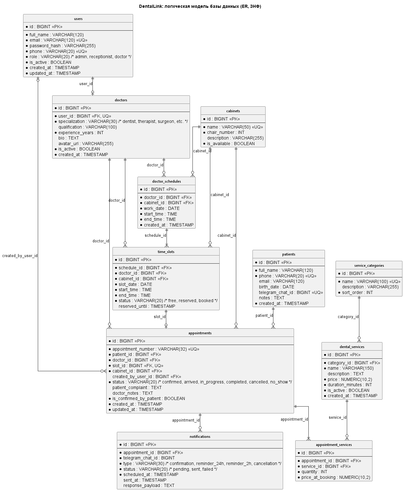

# Лабораторная работа 6. Логическая модель базы данных
## Информационная система «Онлайн-запись в стоматологию» (DentalLink)

---

## 1. Исходная ненормализованная таблица (Журнал предварительной записи клиники в Excel)

До внедрения информационной системы DentalLink регистратура стоматологической клиники вела единый журнал предварительной записи и приёмов пациентов в формате электронных таблиц Excel. Ниже приведён репрезентативный фрагмент этого журнала с вымышленными данными.

| № записи / талона | Пациент (ФИО, телефон, e-mail) | Дата и время приёма | Кабинет и кресло | Врач (ФИО, специализация, стаж, телефон) | Оказанные / выбранные услуги (код, наименование, категория, цена) | Итого к оплате (сомони) | Статус визита | Ответственный регистратор (ФИО, логин) |
|---|---|---|---|---|---|---|---|---|
| DL-20261112-001 | Каримов Шухрат Рустамович, +992 90 111 2233, shuhrat.k@mail.tj | 12.11.2026 09:00–10:00 | Кабинет №1 (Терапия), Кресло 1 | Рахимов Алишер Баходурович, Терапевт, 12 лет, +992 92 777 0001 | SRV-01: Консультация и осмотр (Терапия, 100 TJS); SRV-04: Пломбирование световой пломбой (Терапия, 350 TJS) | 450 | Завершён | Саидова Нигина (n.saidova) |
| DL-20261112-002 | Назарова Мадина Собировна, +992 93 222 3344, madina@inbox.tj | 12.11.2026 10:30–11:30 | Кабинет №2 (Хирургия), Кресло 1 | Умаров Джамшед Каримович, Хирург-имплантолог, 15 лет, +992 92 777 0002 | SRV-10: Удаление ретинированного зуба (Хирургия, 500 TJS) | 500 | Подтверждён | Саидова Нигина (n.saidova) |
| DL-20261112-003 | Каримов Шухрат Рустамович, +992 90 111 2233, shuhrat.k@mail.tj | 19.11.2026 14:00–15:00 | Кабинет №3 (Ортодонтия), Кресло 1 | Турсунова Зарина Мурадовна, Ортодонт, 8 лет, +992 92 777 0003 | SRV-15: Установка брекет-системы (Ортодонтия, 4500 TJS) | 4500 | Подтверждён | Давлатов Рустам (r.davlatov) |
| DL-20261112-004 | Шарипов Фарход Акбарович, +992 98 555 4433, farhod.sh@mail.tj | 12.11.2026 11:30–12:30 | Кабинет №1 (Терапия), Кресло 1 | Рахимов Алишер Баходурович, Терапевт, 12 лет, +992 92 777 0001 | SRV-02: Профессиональная гигиена ультразвуком (Гигиена, 300 TJS) | 300 | На приёме | Саидова Нигина (n.saidova) |

Данная таблица находится в **ненормализованной форме (UNF)** и содержит многочисленные аномалии вставки, обновления и удаления данных.

---

## 2. Нормализация базы данных

### 2.1. Приведение к первой нормальной форме (1НФ)

**Критерий 1НФ:**
1. Все атрибуты являются простыми (атомарными), в каждой ячейке содержится ровно одно неделимое скалярное значение.
2. В таблице отсутствуют повторяющиеся группы строк или столбцов.
3. Отсутствуют вычисляемые значения, которые могут быть динамически получены из других полей.

**Что нарушало 1НФ в исходной таблице:**
- **Составные неатомарные атрибуты:**
  - `Пациент`: объединяет ФИО, номер телефона и адрес электронной почты.
  - `Кабинет и кресло`: объединяет наименование кабинета, медицинский профиль и номер рабочего кресла/установки.
  - `Врач`: объединяет ФИО, врачебную специализацию, стаж работы и контактный телефон.
  - `Ответственный регистратор`: объединяет ФИО и системный логин учётной записи.
  - `Дата и время приёма`: строковый интервал, объединяющий календарную дату, время начала и время окончания.
- **Повторяющиеся группы / множественные значения в одной ячейке:**
  - Столбец `Оказанные / выбранные услуги` содержит перечисление процедур через точку с запятой (в строке 1 записано сразу две услуги с кодами, названиями и ценами).
- **Вычисляемое значение:**
  - Столбец `Итого к оплате` является суммой стоимостей выбранных услуг.

**Как исправлено (приведение к 1НФ):**
1. Все составные поля декомпозированы на самостоятельные атомарные атрибуты (`full_name`, `phone`, `email`, `chair_number`, `work_date`, `start_time`, `end_time` и т.д.).
2. Перечисление услуг вынесено из ячейки: отношение «приём — услуги» выделено в отдельную сущность, где каждая строка представляет ровно одну оказанную услугу в рамках визита с фиксацией её стоимости на момент оформления.
3. Вычисляемый столбец «Итого к оплате» удалён из схемы БД. Итоговая стоимость рассчитывается на уровне SQL-запроса агрегатной функцией `SUM(quantity * price_at_booking)`.

---

### 2.2. Приведение ко второй нормальной форме (2НФ)

**Критерий 2НФ:**
1. Таблица находится в 1НФ.
2. Каждый неключевой атрибут функционально полно зависит от первичного ключа (отсутствуют частичные функциональные зависимости неключевых атрибутов от части составного первичного ключа).

**Что нарушало 2НФ:**
- Если бы исходная таблица после устранения списков услуг использовала составной естественный первичный ключ (например, `[номер_записи, код_услуги]` или `[телефон_пациента, id_врача, дата_время]`), то:
  - атрибуты пациента (`full_name`, `phone`, `email`) зависели бы только от части ключа `номер_записи` (или `телефон_пациента`), а не от `код_услуги`;
  - атрибуты услуги (`наименование_услуги`, `цена`) зависели бы исключительно от `код_услуги`;
  - атрибуты врача зависели бы исключительно от врача.
- Это порождало дублирование информации при многократных записях одного и того же пациента или назначении нескольких услуг в один приём.

**Как исправлено (приведение к 2НФ):**
1. Во всех проектных таблицах в качестве первичного ключа введён **суррогатный целочисленный ключ `id` (BIGINT)** с автоинкрементом / системной последовательностью.
2. Поскольку первичный ключ каждой результирующей таблицы состоит ровно из одного столбца (`id`), частичные функциональные зависимости математически невозможны: любой неключевой атрибут таблицы функционально зависит от суррогатного ключа таблицы целиком.

---

### 2.3. Приведение к третьей нормальной форме (3НФ)

**Критерий 3НФ:**
1. Таблица находится во 2НФ.
2. В таблице отсутствуют транзитивные функциональные зависимости неключевых атрибутов от первичного ключа (если неключевой атрибут $A$ определяет неключевой атрибут $B$, то зависимость $PK \to A \to B$ является транзитивной и нарушает 3НФ).

**Выявленные транзитивные зависимости и принятые проектные решения:**

| Транзитивная зависимость | Причина нарушения 3НФ | Решение по нормализации (выделение таблиц) |
|---|---|---|
| `appointment → doctor → user` | Персональные данные врача (ФИО, email, телефон, пароль) зависят от системного пользователя, а не от записи на приём | Выделена таблица `users` (учётные записи персонала) и таблица `doctors` с внешним ключом `doctors.user_id → users.id` (1:1) |
| `appointment → doctor → specialization, experience_years` | Врачебная специализация, квалификация и стаж определяются доктором, а не конкретным визитом | Выделена таблица `doctors`, в таблице `appointments` остаётся только внешний ключ `doctor_id` |
| `appointment → cabinet → chair_number, is_available` | Количество кресел и доступность кабинета зависят от самого кабинета, а не от приёма | Выделена таблица `cabinets`, в таблице `appointments` остаётся внешний ключ `cabinet_id` |
| `appointment → patient → phone, email, birth_date` | Персональные и контактные данные пациента определяются личностью пациента, а не номером визита | Выделена таблица `patients`, в таблице `appointments` остаётся внешний ключ `patient_id` |
| `dental_service → service_category → sort_order, description` | Описание категории и порядок её отображения зависят от категории, а не от конкретной процедуры | Выделена таблица `service_categories`, а в таблице `dental_services` оставлен внешний ключ `category_id` |
| `appointment → time_slot → slot_date, start_time, end_time` | Временные рамки приёма определяются сгенерированным слотом сетки расписания | Выделена таблица `time_slots` (и родительская `doctor_schedules`), в `appointments` остаётся ключ `slot_id` |

**Проверка на аномалии модификации данных:**
- **Аномалия обновления (Update Anomaly):** при смене номера телефона врача или переименовании категории услуг («Терапия» $\to$ «Терапевтическая стоматология») изменение затрагивает ровно одну запись в таблице `users` или `service_categories`, а не сотни архивных строк в журнале приёмов.
- **Аномалия вставки (Insert Anomaly):** можно создать новый кабинет, услугу или зарегистрировать врача до того, как к нему запишется первый пациент.
- **Аномалия удаления (Delete Anomaly):** отмена или удаление записи на приём не приводит к безвозвратной потере информации о пациенте, враче, кабинете или прейскуранте услуг.

---

## 3. Описание сущностей (Таблицы базы данных)

Именование всех таблиц выполнено в нижнем регистре на английском языке во множественном числе (`snake_case`). Имена внешних ключей строго следуют соглашению `<сущность_в_единственном_числе>_id`.

### 3.1. `users` — учётные записи персонала клиники
Хранит учётные данные сотрудников клиники (администраторы, врачи, управляющие). Пациенты работают без постоянного парольного аккаунта.

| Атрибут | Тип | Ключ | NULL | Описание |
|---|---|---|---|---|
| `id` | BIGINT | PK | нет | Суррогатный первичный ключ |
| `full_name` | VARCHAR(120) | | нет | ФИО сотрудника |
| `email` | VARCHAR(120) | UQ | нет | Корпоративный e-mail (логин) |
| `password_hash` | VARCHAR(255) | | нет | Хэш пароля (BCrypt / ASP.NET Identity) |
| `phone` | VARCHAR(20) | UQ | нет | Контактный номер телефона |
| `role` | VARCHAR(20) | | нет | Роль доступа: `'admin'`, `'receptionist'`, `'doctor'` |
| `is_active` | BOOLEAN | | нет | Флаг активности учётной записи (активен/заблокирован) |
| `created_at` | TIMESTAMP | | нет | Дата и время создания учётной записи |
| `updated_at` | TIMESTAMP | | нет | Дата и время последнего обновления профиля |

---

### 3.2. `doctors` — профили врачей-стоматологов
Расширяет учётную запись пользователя (`users`) профессиональными медицинскими сведениями.

| Атрибут | Тип | Ключ | NULL | Описание |
|---|---|---|---|---|
| `id` | BIGINT | PK | нет | Суррогатный первичный ключ |
| `user_id` | BIGINT | FK → users.id, UQ | нет | Ссылка на базовую учётную запись пользователя (1:1) |
| `specialization` | VARCHAR(30) | | нет | Направление: `'dentist'`, `'therapist'`, `'orthopedist'`, `'orthodontist'`, `'surgeon'`, `'implantologist'`, `'pediatric'`, `'hygienist'` |
| `qualification` | VARCHAR(100) | | да | Врачебная категория / учёная степень |
| `experience_years` | INT | | нет | Стаж практической работы (лет) |
| `bio` | TEXT | | да | Краткая биография и профессиональное резюме |
| `avatar_url` | VARCHAR(255) | | да | Ссылка на фото врача |
| `is_active` | BOOLEAN | | нет | Признак ведения приёма (работает/в отпуске/уволен) |
| `created_at` | TIMESTAMP | | нет | Дата и время добавления карточки врача |

---

### 3.3. `cabinets` — лечебные кабинеты клиники
Хранит справочник кабинетов и стоматологических установок.

| Атрибут | Тип | Ключ | NULL | Описание |
|---|---|---|---|---|
| `id` | BIGINT | PK | нет | Суррогатный первичный ключ |
| `name` | VARCHAR(50) | UQ | нет | Название кабинета (например, «Кабинет №1 (Терапия)») |
| `chair_number` | INT | | нет | Номер стоматологической установки / кресла |
| `description` | VARCHAR(255) | | да | Оснащение кабинета (рентген-аппарат, микроскоп и т.д.) |
| `is_available` | BOOLEAN | | нет | Доступность для составления расписания |

---

### 3.4. `service_categories` — категории стоматологических услуг
Группирует услуги прейскуранта в логические разделы каталога.

| Атрибут | Тип | Ключ | NULL | Описание |
|---|---|---|---|---|
| `id` | BIGINT | PK | нет | Суррогатный первичный ключ |
| `name` | VARCHAR(100) | UQ | нет | Наименование категории (Терапия, Хирургия, Ортодонтия) |
| `description` | VARCHAR(255) | | да | Краткое описание направления |
| `sort_order` | INT | | нет | Порядок отображения в меню на сайте клиники |

---

### 3.5. `dental_services` — справочник стоматологических услуг
Содержит действующий прейскурант медицинских услуг и типовую продолжительность процедур.

| Атрибут | Тип | Ключ | NULL | Описание |
|---|---|---|---|---|
| `id` | BIGINT | PK | нет | Суррогатный первичный ключ |
| `category_id` | BIGINT | FK → service_categories.id | нет | Категория, к которой относится услуга |
| `name` | VARCHAR(150) | | нет | Название услуги (например, «Лечение кариеса») |
| `description` | TEXT | | да | Подробное описание процедуры для пациента |
| `price` | NUMERIC(10,2) | | нет | Базовая стоимость услуги (в сомони, TJS) |
| `duration_minutes` | INT | | нет | Стандартная длительность приёма в минутах (кратно 30 мин) |
| `is_active` | BOOLEAN | | нет | Флаг доступности услуги для онлайн-записи |
| `created_at` | TIMESTAMP | | нет | Дата внесения позиции в прейскурант |

---

### 3.6. `doctor_schedules` — график смен врачей
Определяет планируемые рабочие смены врачей с закреплением за конкретным кабинетом на дату.

| Атрибут | Тип | Ключ | NULL | Описание |
|---|---|---|---|---|
| `id` | BIGINT | PK | нет | Суррогатный первичный ключ |
| `doctor_id` | BIGINT | FK → doctors.id | нет | Врач, выходящий на смену |
| `cabinet_id` | BIGINT | FK → cabinets.id | нет | Назначенный кабинет |
| `work_date` | DATE | | нет | Календарная дата смены |
| `start_time` | TIME | | нет | Время начала смены (например, 09:00) |
| `end_time` | TIME | | нет | Время окончания смены (например, 15:00) |
| `created_at` | TIMESTAMP | | нет | Дата и время формирования смены |

---

### 3.7. `time_slots` — временные слоты расписания
Дискретные интервалы приёма с шагом 30 минут, сгенерированные на основе смены.

| Атрибут | Тип | Ключ | NULL | Описание |
|---|---|---|---|---|
| `id` | BIGINT | PK | нет | Суррогатный первичный ключ |
| `schedule_id` | BIGINT | FK → doctor_schedules.id | нет | Смена, в рамках которой сгенерирован интервал |
| `doctor_id` | BIGINT | FK → doctors.id | нет | Врач, ведущий приём |
| `cabinet_id` | BIGINT | FK → cabinets.id | нет | Кабинет приёма |
| `slot_date` | DATE | | нет | Дата слота |
| `start_time` | TIME | | нет | Начало слота (например, 10:00) |
| `end_time` | TIME | | нет | Конец слота (например, 10:30) |
| `status` | VARCHAR(20) | | нет | Статус слота: `'free'`, `'reserved'`, `'booked'` |
| `reserved_until` | TIMESTAMP | | да | Время истечения временной блокировки (TTL 10 мин) |

---

### 3.8. `patients` — картотека пациентов
Хранит персональные данные пациентов, записавшихся на приём.

| Атрибут | Тип | Ключ | NULL | Описание |
|---|---|---|---|---|
| `id` | BIGINT | PK | нет | Суррогатный первичный ключ |
| `full_name` | VARCHAR(120) | | нет | ФИО пациента |
| `phone` | VARCHAR(20) | UQ | нет | Контактный номер телефона (основной идентификатор) |
| `email` | VARCHAR(120) | | да | E-mail для чеков и уведомлений |
| `birth_date` | DATE | | да | Дата рождения |
| `telegram_chat_id` | BIGINT | UQ | да | Идентификатор чата в Telegram Bot для подтверждений |
| `notes` | TEXT | | да | Медицинские примечания (аллергии, особенности) |
| `created_at` | TIMESTAMP | | нет | Дата первого обращения в клинику |

---

### 3.9. `appointments` — журнал записей на приём
Центральная операционная сущность системы, фиксирующая факт визита пациента к врачу.

| Атрибут | Тип | Ключ | NULL | Описание |
|---|---|---|---|---|
| `id` | BIGINT | PK | нет | Суррогатный первичный ключ |
| `appointment_number` | VARCHAR(32) | UQ | нет | Уникальный номер талона (например, `DL-20261112-001`) |
| `patient_id` | BIGINT | FK → patients.id | нет | Пациент |
| `doctor_id` | BIGINT | FK → doctors.id | нет | Врач, проводящий приём |
| `slot_id` | BIGINT | FK → time_slots.id, UQ | нет | Забронированный слот расписания (1:1) |
| `cabinet_id` | BIGINT | FK → cabinets.id | нет | Кабинет проведения процедуры |
| `created_by_user_id` | BIGINT | FK → users.id | да | Регистратор, оформивший запись (NULL при онлайн-записи) |
| `status` | VARCHAR(20) | | нет | Статус: `'confirmed'`, `'arrived'`, `'in_progress'`, `'completed'`, `'cancelled'`, `'no_show'` |
| `patient_complaint` | TEXT | | да | Жалобы пациента при записи |
| `doctor_notes` | TEXT | | да | Заключение врача по итогам осмотра |
| `is_confirmed_by_patient` | BOOLEAN | | нет | Отметка о подтверждении визита через Telegram / звонок |
| `created_at` | TIMESTAMP | | нет | Дата и время создания бронирования |
| `updated_at` | TIMESTAMP | | нет | Время последнего изменения статуса |

---

### 3.10. `appointment_services` — услуги в приёме (Таблица-связка M:N)
Реализует отношение многие-ко-многим (M:N) между визитами пациентов (`appointments`) и услугами прейскуранта (`dental_services`). В рамках одного приёма может быть оказано несколько услуг, а одна и та же услуга оказывается во множестве приёмов.

| Атрибут | Тип | Ключ | NULL | Описание |
|---|---|---|---|---|
| `id` | BIGINT | PK | нет | Суррогатный первичный ключ связи |
| `appointment_id` | BIGINT | FK → appointments.id | нет | Идентификатор визита |
| `service_id` | BIGINT | FK → dental_services.id | нет | Идентификатор оказанной стоматологической услуги |
| `quantity` | INT | | нет | Количество оказанных услуг / единиц (по умолчанию 1) |
| `price_at_booking` | NUMERIC(10,2) | | нет | Зафиксированная цена услуги на момент записи/оказания |

---

### 3.11. `notifications` — очередь и журнал Telegram-уведомлений
Хранит расписание и журнал отправки сервисных сообщений и напоминаний о приёме через Telegram Bot.

| Атрибут | Тип | Ключ | NULL | Описание |
|---|---|---|---|---|
| `id` | BIGINT | PK | нет | Суррогатный первичный ключ |
| `appointment_id` | BIGINT | FK → appointments.id | нет | Запись на приём, к которой относится оповещение |
| `telegram_chat_id` | BIGINT | | нет | Идентификатор адресата в Telegram |
| `type` | VARCHAR(30) | | нет | Тип: `'confirmation'`, `'reminder_24h'`, `'reminder_2h'`, `'cancellation'` |
| `status` | VARCHAR(20) | | нет | Статус доставки: `'pending'`, `'sent'`, `'failed'` |
| `scheduled_at` | TIMESTAMP | | нет | Запланированное время отправки сообщения |
| `sent_at` | TIMESTAMP | | да | Фактическое время успешной доставки |
| `response_payload` | TEXT | | да | Ответное действие пациента (нажатие кнопки «Подтверждаю») |

---

## 4. Связи между таблицами

| Связь | Тип связи | Внешний ключ (FK) | Обязательность со стороны зависимой | Бизнес-смысл |
|---|---|---|---|---|
| `users` — `doctors` | 1:1 (необязательная) | `doctors.user_id` (UNIQUE) | Да (врач обязан иметь аккаунт) | Учётная запись сотрудника расширяется до профиля врача. Администраторы не являются докторами |
| `service_categories` — `dental_services` | 1:N | `dental_services.category_id` | Да (услуга обязана иметь категорию) | Рубрикация стоматологических услуг в прейскуранте |
| `doctors` — `doctor_schedules` | 1:N | `doctor_schedules.doctor_id` | Да | Назначение врача на рабочую смену |
| `cabinets` — `doctor_schedules` | 1:N | `doctor_schedules.cabinet_id` | Да | Назначение кабинета для рабочей смены |
| `doctor_schedules` — `time_slots` | 1:N | `time_slots.schedule_id` | Да | Генерация 30-минутных слотов внутри смены |
| `doctors` — `time_slots` | 1:N | `time_slots.doctor_id` | Да | Прямая привязка слота к врачу для быстрого поиска свободных окон |
| `cabinets` — `time_slots` | 1:N | `time_slots.cabinet_id` | Да | Закрепление физического кабинета за интервалом |
| `patients` — `appointments` | 1:N | `appointments.patient_id` | Да | Пациент может иметь множество визитов в клинику за всё время |
| `doctors` — `appointments` | 1:N | `appointments.doctor_id` | Да | Врач проводит множество приёмов |
| `cabinets` — `appointments` | 1:N | `appointments.cabinet_id` | Да | Приём проходит в конкретном кабинете |
| `time_slots` — `appointments` | 1:1 (необязательная) | `appointments.slot_id` (UNIQUE) | Да | Слот может быть занят максимум одним приёмом |
| `users` — `appointments` | 1:N (необязательная) | `appointments.created_by_user_id` | Нет (NULL при онлайн-бронировании) | Фиксация администратора, создавшего запись по телефону |
| `appointments` — `appointment_services` | 1:N | `appointment_services.appointment_id` | Да | Приём может включать одну или несколько медицинских манипуляций |
| `dental_services` — `appointment_services` | 1:N | `appointment_services.service_id` | Да | Одна процедура из прейскуранта фигурирует во множестве визитов |
| `appointments` — `notifications` | 1:N | `notifications.appointment_id` | Да | Автоматические напоминания за 24 ч и 2 ч до визита |

> **Реализация связи многие-ко-многим (M:N):**
> Связь между сущностями `appointments` (Приёмы) и `dental_services` (Услуги) имеет кардинальность **M:N** («многие ко многим»). В реляционной СУБД данная связь декомпозирована на две связи **1:N** с помощью промежуточной таблицы-связки `appointment_services(appointment_id, service_id, quantity, price_at_booking)`. Атрибут `price_at_booking` сохраняет историческую стоимость услуги на момент создания записи, защищая финансовые отчёты от последующего изменения цен в основном прейскуранте.

---

## 5. Ограничения целостности (Integrity Constraints)

### 5.1. Ограничения уникальности (UNIQUE)
1. `users.email` — исключает регистрацию двух сотрудников с одинаковым адресом корпоративной почты.
2. `users.phone` — обеспечивает однозначность номера телефона персонала при авторизации и оповещениях.
3. `doctors.user_id` — гарантирует отношение 1:1 между учётной записью пользователя и профилем доктора.
4. `cabinets.name` — предотвращает дублирование названий кабинетов в клинике.
5. `service_categories.name` — исключает создание повторяющихся разделов каталога услуг.
6. `patients.phone` — телефон является главным уникальным идентификатором пациента клиники без парольного входа.
7. `patients.telegram_chat_id` — уникальный идентификатор чата в Telegram Bot для адресной отправки сообщений.
8. `appointments.appointment_number` — уникальный код талона записи для поиска и идентификации в SMS/Telegram.
9. `appointments.slot_id` — гарантирует, что конкретный временной слот не может быть забронирован повторно (аппаратная защита от double-booking на уровне СУБД).
10. `time_slots (doctor_id, slot_date, start_time)` — составное ограничение: исключает наложение интервалов у одного врача.

---

### 5.2. Ограничения проверок (CHECK)
1. `CHECK (dental_services.price >= 0)` — стоимость медицинской услуги в прейскуранте не может быть отрицательной.
2. `CHECK (dental_services.duration_minutes > 0 AND dental_services.duration_minutes % 30 = 0)` — длительность процедуры должна быть строго положительной и кратной шагу сетки расписания (30 минут).
3. `CHECK (appointment_services.quantity > 0)` — количество оказанных процедур в рамках одного визита должно быть не менее 1.
4. `CHECK (appointment_services.price_at_booking >= 0)` — зафиксированная цена услуги на момент приёма не может быть отрицательной.
5. `CHECK (time_slots.end_time > time_slots.start_time)` — время завершения временного интервала должно быть строго позже времени его начала.
6. `CHECK (doctor_schedules.end_time > doctor_schedules.start_time)` — окончание смены врача должно быть позже её начала.
7. `CHECK (doctors.experience_years >= 0)` — стаж работы врача не может быть отрицательным числом.
8. `CHECK (cabinets.chair_number > 0)` — номер стоматологической установки/кресла в кабинете должен быть положительным числом.

---

### 5.3. Правила удаления связанных записей (ON DELETE)

| Внешний ключ | Ссылается на | Правило ON DELETE | Обоснование выбора правила |
|---|---|---|---|
| `doctors.user_id` | `users.id` | **RESTRICT** | Запрещено удалять учётную запись пользователя, пока существует привязанная карточка врача. Для деактивации используется `users.is_active = FALSE` |
| `service_categories.id` | `dental_services.category_id` | **RESTRICT** | Нельзя удалить категорию прейскуранта, если в ней содержатся действующие стоматологические услуги |
| `doctor_schedules.doctor_id` | `doctors.id` | **RESTRICT** | Запрещено удалять врача, если в системе зафиксирован график его рабочих смен |
| `doctor_schedules.cabinet_id` | `cabinets.id` | **RESTRICT** | Запрещено удалять кабинет, пока на него назначены смены |
| `time_slots.schedule_id` | `doctor_schedules.id` | **CASCADE** | При отмене/удалении рабочей смены удаляются все сгенерированные ею свободные слоты |
| `time_slots.doctor_id` | `doctors.id` | **RESTRICT** | Запрещено удалять врача, если с ним связаны временные слоты |
| `time_slots.cabinet_id` | `cabinets.id` | **RESTRICT** | Запрещено удалять физический кабинет при наличии связанных слотов |
| `appointments.patient_id` | `patients.id` | **RESTRICT** | Запрещено удалять карточку пациента из базы при наличии истории визитов или активных записей |
| `appointments.doctor_id` | `doctors.id` | **RESTRICT** | Нельзя удалить врача при наличии истории проведённых приёмов (требование сохранности медицинской истории) |
| `appointments.cabinet_id` | `cabinets.id` | **RESTRICT** | Запрещено удалять кабинет, в котором проводились приёмы |
| `appointments.slot_id` | `time_slots.id` | **RESTRICT** | Нельзя удалить временной слот, если на него оформлена действующая запись пациента |
| `appointments.created_by_user_id` | `users.id` | **SET NULL** | При увольнении или удалении учётной записи администратора ресепшена созданные им записи на приём сохраняются в системе |
| `appointment_services.appointment_id` | `appointments.id` | **CASCADE** | При полном физическом удалении записи на приём автоматически удаляются строки состава оказанных в нём услуг |
| `appointment_services.service_id` | `dental_services.id` | **RESTRICT** | Нельзя удалить позицию из прейскуранта, если данная услуга уже была оказана в приёмах (для отключения услуги используется `is_active = FALSE`) |
| `notifications.appointment_id` | `appointments.id` | **CASCADE** | При отмене/удалении приёма все запланированные для него напоминания автоматически удаляются |

---

## 6. ER-диаграмма в нотации Crow's Foot

ER-диаграмма логической модели базы данных DentalLink описана в файле [`docs/06-er-diagram.puml`](06-er-diagram.puml) и скомпилирована в графический файл [`docs/06-er-diagram.png`](06-er-diagram.png).

### Обозначения нотации «воронья лапка» (Crow's Foot):
- `||--||` — связь один к одному, строго обязательная с обеих сторон;
- `||--o|` — связь один к одному, необязательная с зависимой стороны (0 или 1);
- `||--|{` — связь один ко многим, строго обязательная с зависимой стороны (1 или более);
- `||--o{` — связь один ко многим, необязательная со стороны зависимой сущности (0 или более);
- `*` перед атрибутом — обязательное поле (`NOT NULL`);
- отсутствие `*` — допускает значение `NULL`;
- `--` горизонтальная черта — отделяет первичный ключ (`<<PK>>`) от остальных атрибутов таблицы.

---

## 7. Ответы на контрольные вопросы к защите лабораторной работы

### 1. Сформулируйте 1НФ, 2НФ, 3НФ. Покажите на своей исходной таблице, что нарушало каждую форму.
- **1НФ:** таблица находится в 1НФ, если все её атрибуты атомарны (в каждой ячейке хранится ровно одно неделимое значение), нет повторяющихся групп и вычисляемых полей. В исходном Excel-журнале DentalLink 1НФ нарушалась составными столбцами («Пациент (ФИО, телефон, e-mail)», «Врач», «Кабинет и кресло»), списком услуг через точку с запятой в одной ячейке («SRV-01: Консультация...; SRV-04: Пломбирование...») и вычисляемой суммой («Итого к оплате»).
- **2НФ:** таблица находится во 2НФ, если она находится в 1НФ и каждый неключевой атрибут функционально полно зависит от первичного ключа (нет частичных зависимостей от части составного ключа). В исходной таблице составной естественный ключ `[Пациент, Код услуги, Дата]` приводил к тому, что телефон пациента зависел только от пациента, а цена — только от кода услуги. Введение суррогатного ключа `id` в каждой таблице устранило возможность частичных зависимостей.
- **3НФ:** таблица находится в 3НФ, если она находится во 2НФ и нет транзитивных зависимостей неключевых атрибутов от ключа (неключевые атрибуты зависят только от первичного ключа и не зависят от других неключевых атрибутов). В исходной таблице специализация врача зависела от врача, а не от визита (`запись → врач → специализация`); кресло зависело от кабинета (`запись → кабинет → кресло`); категория зависела от услуги (`запись → услуга → категория`). Все транзитивно зависимые сущности были вынесены в отдельные таблицы (`doctors`, `cabinets`, `service_categories`).

### 2. Что такое транзитивная зависимость? Какие аномалии она вызывает при вставке, изменении, удалении?
- **Транзитивная зависимость** — это ситуация, когда неключевой атрибут $Z$ зависит от неключевого атрибута $Y$, который, в свою очередь, зависит от первичного ключа $X$ ($X \to Y \to Z$, при этом обратной зависимости $Y \to X$ нет).
- **Аномалии:**
  - **Аномалия вставки (Insert):** невозможно внести информацию о $Y$ и $Z$ (например, создать новую категорию «Имплантология» или новый кабинет), пока в клинике не появится хотя бы один оформленный приём ($X$).
  - **Аномалия обновления (Update):** если у врача изменился номер телефона или категория услуг была переименована, потребуется обновить тысячи строк журнала приёмов. Если хотя бы в одной строке данные не обновятся, возникнет рассинхронизация и противоречивость базы данных.
  - **Аномалия удаления (Delete):** при удалении последней записи на приём к конкретному врачу или в конкретный кабинет из базы данных безвозвратно удалятся сведения о самом враче или кабинете.

### 3. Как реализуется связь M:N в реляционной БД? Покажите на своей диаграмме.
- Связь «многие ко многим» (M:N) не может быть напрямую выражена через простой внешний ключ в одной из двух таблиц без нарушения 1НФ. В реляционной теории она всегда декомпозируется на две связи типа «один ко многим» (1:N) с помощью промежуточной таблицы-связки (junction table).
- В проекте DentalLink связь M:N между таблицей приёмов `appointments` и таблицей стоматологических услуг `dental_services` реализована через таблицу-связку `appointment_services`:
  - `appointments` (1) $\to$ (N) `appointment_services` (по ключу `appointment_id`);
  - `dental_services` (1) $\to$ (N) `appointment_services` (по ключу `service_id`).
  - Промежуточная таблица также содержит атрибуты связи: `quantity` (количество процедур) и `price_at_booking` (цена услуги на момент оказания).

### 4. Почему `users.phone` или `doctors.user_id` допускает NULL / объявлен UNIQUE? Какую связь это даёт?
- В таблице `doctors` поле `user_id` имеет ограничение `UNIQUE` и внешний ключ на `users.id`. Это гарантирует, что одной учётной записи пользователя соответствует максимум один профиль доктора. Поскольку у администраторов ресепшена профиля врача нет, эта связь является **1:1 (один к одному), необязательной** со стороны пользователя.
- В таблице `appointments` поле `created_by_user_id` допускает `NULL`, но ссылается на `users.id`. Если пациент записался самостоятельно через веб-сайт, поле остаётся `NULL`. Если же запись внесена сотрудником ресепшена, поле заполняется `id` этого администратора.

### 5. Чем суррогатный ключ отличается от естественного? Почему номер приказа / номер записи не взят первичным ключом?
- **Естественный ключ** — это атрибут предметной области, существующий в реальном мире (номер паспорта, номер талона записи, номер приказа, email).
- **Суррогатный ключ** — это искусственно созданное поле (обычно числовой счетчик `id` типа `BIGINT IDENTITY` или `UUID`), не несущее смысловой нагрузки бизнес-логики.
- **Почему номер талона/записи (`appointment_number`) не взят первичным ключом:**
  1. Естественные ключи могут меняться по требованиям регламента или законодательства (например, смена маски нумерации талонов). Смена PK каскадно затрагивает все связанные таблицы (`appointment_services`, `notifications`).
  2. Строковые ключи (`VARCHAR`) занимают больше места на диске и в индексах B-Tree, а операции сравнения строк в JOIN медленнее, чем сравнение целочисленных 64-битных значений (`BIGINT`).
  3. Поэтому суррогатный `id` используется как первичный ключ (PK), а уникальность номера записи гарантируется отдельным ограничением `UNIQUE(appointment_number)`.

### 6. Что произойдёт при попытке удалить запись, на которую ссылаются другие таблицы, при вашем правиле ON DELETE?
- **При `ON DELETE RESTRICT`:** СУБД заблокирует операцию удаления и вернет ошибку нарушения внешнего ключа. Например, если попытаться удалить услугу из `dental_services`, которая уже была оказана в приёмах (`appointment_services`), СУБД отклонит запрос, сохранив целостность финансовых и медицинских отчётов.
- **При `ON DELETE CASCADE`:** СУБД автоматически удалит все дочерние связанные строки. Например, при удалении приёма `appointments` автоматически удалятся связанные записи оказанных услуг `appointment_services` и запланированные уведомления `notifications`.
- **При `ON DELETE SET NULL`:** СУБД оставит дочерние строки, но заменит значение внешнего ключа на `NULL`. Например, при удалении аккаунта уволенного регистратора из `users` в записях `appointments` поле `created_by_user_id` станет `NULL`, но сам факт записи и история визита пациента останутся неизменными.
