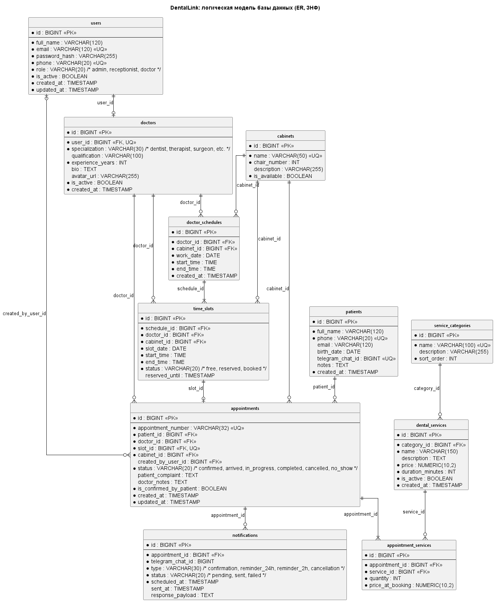
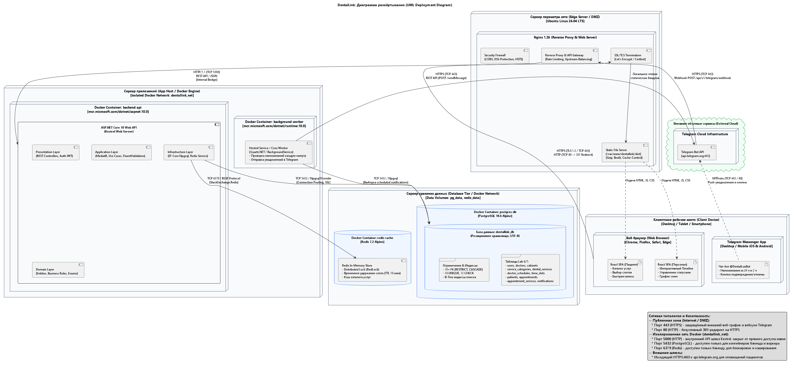

# Техническое задание на разработку специализированной веб-системы онлайн-записи и управления расписанием стоматологической клиники «DentalLink»

**Версия:** 1.0  
**Дата составления:** 15.11.2026  
**Разработчик:** Акрамзода Мухриддин, студент гр. (уточняется)  
**Заказчик:** Стоматологическая клиника «ДенталЛюкс» (условно)  
**Статус документа:** Согласовано к рубежному контролю РК-1  

---

## 1. Общие сведения

### 1.1. Полное и краткое наименование системы
- **Полное наименование:** Специализированная медицинская веб-система онлайн-записи пациентов и управления расписанием приёмов стоматологической клиники.
- **Краткое наименование:** ИС «DentalLink» (DentalLink).

### 1.2. Основание для разработки
Разработка ведётся в рамках учебного плана дисциплины «Проектирование информационных систем», а также на основании модели бизнес-требований и технического задания на автоматизацию операционной деятельности стоматологической клиники «ДенталЛюкс».

### 1.3. Сведения о заказчике и разработчике
- **Заказчик (условно):** Стоматологическая клиника «ДенталЛюкс» (частное медицинское учреждение: 5 лечебных кабинетов/кресел, 10 врачей-стоматологов основных направлений).
- **Разработчик (исполнитель):** студент Акрамзода Мухриддин.

### 1.4. Сроки выполнения работ
- **Плановый период разработки:** осенний семестр 2026/2027 учебного года (ноябрь 2026 г. – декабрь 2026 г.).
- **Сдача этапа проектирования и защиты ТЗ (РК-1):** день 8 (ноябрь 2026 г.).
- **Сдача готового программного продукта и защита MVP (РК-2):** день 16 (декабрь 2026 г.).

---

## 2. Назначение и цели создания системы

### 2.1. Назначение системы
Веб-система **DentalLink** предназначена для комплексной автоматизации процессов взаимодействия стоматологической клиники с пациентами:
1. Предоставление пациентам современного, интуитивно понятного адаптивного портала для круглосуточного выбора врача, ознакомления с прейскурантом услуг и мгновенного бронирования свободных окон приёма в реальном времени.
2. Предоставление персоналу клиники (администраторам ресепшена и руководству) интерактивного автоматизированного рабочего места с календарной сеткой расписания (Timeline) для оперативного управления записями, исключения накладок и контроля доступности кресел.
3. Предоставление врачам-стоматологам персонального расписания визитов с возможностью оперативной фиксации этапов приёма («На приёме», «Завершён», «Не явился»).
4. Автоматизация сервисных напоминаний и двухэтапного интерактивного подтверждения визитов через официальный Telegram Bot API.

### 2.2. Измеримые цели создания системы
Внедрение системы ориентировано на достижение следующих ключевых количественных и качественных показателей:

| № | Показатель / Проблема | Текущее состояние (ручной процесс) | Целевое значение в DentalLink | Измеримый эффект |
|---|---|---|---|---|
| 1 | **Время оформления записи пациентом** | 5–10 минут (звонок на ресепшен, ожидание ответа, ручной перебор дат) | **≤ 1 минуты** через веб-интерфейс (2 шага: выбор времени + телефон/имя) | Ускорение процедуры записи в 5–10 раз |
| 2 | **Доля неявок пациентов (No-Show)** | 20–25 % от всех подтверждённых записей из-за человеческого фактора и забывчивости | **менее 7 %** | Снижение потерь рабочего времени врачей более чем в 3 раза за счёт напоминаний за 24 ч и 2 ч в Telegram |
| 3 | **Коллизии и двойная запись (Double-booking)** | До 3–5 накладок в неделю при одновременных звонках двум администраторам | **0 случаев (100% защита)** | Исключение накладок благодаря распределённому удержанию слота (Slot Hold 10 мин) в Redis и транзакциям БД |
| 4 | **Доступность записи во внерабочее время** | 0 % (с 21:00 до 09:00 ресепшен не отвечает, потеря до 30% потенциальных обращений) | **100 % (круглосуточно 24/7)** | Привлечение дополнительного потока пациентов во внерабочие часы клиники |
| 5 | **Трудозатраты администраторов на рутинные звонки** | До 70 % рабочего времени ресепшена уходит на ответы о свободных окнах и ценах | **Снижение на 60–70 %** | Освобождение времени персонала для качественного очного приёма пациентов в холле |
| 6 | **Скорость работы интерфейса** | Задержки агрегаторов и МИС (LCP 3–5 с) | **LCP ≤ 1,2 с; PageSpeed Desktop ≥ 85** | Мгновенный отклик SPA без утяжеляющих сторонних маркетинговых скриптов |

---

## 3. Характеристика объекта автоматизации

### 3.1. Сведения об организации
Объектом автоматизации является стоматологическая клиника «ДенталЛюкс» — современный стоматологический центр, располагающий:
- 5 изолированными стоматологическими кабинетами с индивидуальными лечебными установками (креслами);
- Штатом из 10 врачей-стоматологов по 8 ключевым медицинским направлениям: терапевтическая стоматология, ортопедия (протезирование), ортодонтия (брекет-системы и элайнеры), хирургия, имплантология, детская стоматология, профессиональная гигиена и профилактика, общий консультативный приём;
- Графиком работы: ежедневно с 09:00 до 21:00 без выходных и перерывов;
- Шагом сетки расписания приёмов: **30 минут** (процедуры длительностью 60 или 90 минут последовательно занимают 2 или 3 смежных слота);
- Ежедневным потоком: от 60 до 90 звонков и очных обращений.

### 3.2. Текущее состояние процессов и предпосылки автоматизации
До внедрения системы DentalLink учёт записей в клинике строился на ведении локальной таблицы Microsoft Excel и бумажного журнала на ресепшене. Выявлены следующие критические недостатки:
1. **Ошибки и накладки расписания (Double-booking):** при одновременном согласовании времени двумя администраторами на стойке регулярно возникают конфликты записи к одному врачу или в один кабинет.
2. **Высокий процент неявок (No-Show):** администраторы физически не успевают обзванивать 40–50 пациентов в день для подтверждения визита. Пациенты забывают о визите, клиника теряет до 25% планируемой выручки.
3. **Потеря пациентов во внерабочее время:** пациенты, ощутившие зубную боль вечером или в выходные дни, не имеют возможности забронировать приём онлайн и уходят к конкурентам.
4. **Нерациональная нагрузка на персонал:** администраторы перегружены однотипными телефонными консультациями по ценам и свободному времени врачей.
5. **Отсутствие аналитических данных:** руководство клиники не имеет точных данных о коэффициенте загрузки каждого кресла и эффективности рабочего времени врачей.

### 3.3. Акторы системы

| Роль в системе | Описание роли | Основные функции и сценарии в DentalLink |
|---|---|---|
| **patient** (Пациент) | Конечный потребитель стоматологических услуг | Просматривает каталог специалистов и прейскурант, выбирает дату и свободное окно, оформляет запись по номеру телефона без паролей, получает интерактивные напоминания в Telegram, просматривает и при необходимости отменяет свой визит. |
| **receptionist** (Администратор ресепшена) | Сотрудник стойки регистрации клиники | Ведёт общую интерактивную сетку расписания клиники (Timeline), оформляет записи при телефонных звонках и личном визите пациентов, осуществляет перенос и отмену визитов, фиксирует статус явки пациента (`arrived`). |
| **doctor** (Врач-стоматолог) | Медицинский специалист клиники | Просматривает личный график приёмов на смену, видит контакты пациента и заявленную причину визита, переводит статус приёма в `in_progress` («На приёме») и `completed` («Завершён»), вносит лечебные комментарии. |
| **admin** (Управляющий / Главный администратор) | Руководитель клиники / системный администратор | Управляет структурой кабинетов и кресел, формирует график рабочих смен врачей, ведёт каталог услуг и прейскурант цен, администрирует учётные записи сотрудников, формирует сводные отчёты по загрузке. |

### 3.4. Описание основных бизнес-процессов

#### Процесс 1. Онлайн-запись пациента через веб-портал
1. Пациент открывает веб-сервис DentalLink, выбирает специализацию, услугу или желаемого врача-стоматолога.
2. Система отображает карточку доктора и календарь свободных временных слотов на выбранную дату.
3. Пациент выбирает временной слот (например, 14:00).
4. Сервер инициирует временное удержание слота (Slot Hold) на 10 минут, переводя статус слота в базе данных в `reserved` и фиксируя распределённую блокировку в Redis. Для других клиентов слот визуально становится недоступным.
5. Пациент указывает имя, номер телефона и краткую жалобу, после чего нажимает «Записаться».
6. Сервер в транзакции сохраняет запись в таблице `appointments` со статусом `confirmed`, фиксирует занятость слота в таблице `time_slots` со статусом `booked` и освобождает блокировку в Redis.
7. Пациенту отображается экран с талоном записи и ссылкой для подключения к Telegram-боту клиники.

#### Процесс 2. Ручная запись и перенос администратором (Timeline)
1. Пациент звонит в клинику или обращается очно на стойку ресепшена.
2. Администратор в сетке Timeline находит свободный интервал нужного врача и кликает по нему.
3. В модальном окне администратор выбирает услугу, вводит номер телефона и имя пациента.
4. Система проверяет отсутствие накладок и фиксирует запись со статусом `confirmed`, указывая ID создавшего запись администратора.
5. При необходимости переноса администратор перетаскивает (или редактирует) блок приёма на новое свободное время: старый слот освобождается (`free`), а новый становится `booked`.

#### Процесс 3. Двухэтапная цепочка напоминаний через Telegram Bot
1. За 24 часа до назначенного времени фоновая служба системы формирует уведомление со статусом `pending`.
2. Фоновый сервис (Background Worker) через Telegram Bot API отправляет пациенту сообщение с деталями приёма (врач, кабинет, адрес клиники, время) и двумя кнопками: «Подтверждаю» и «Отменить/Перенести».
3. При нажатии «Подтверждаю» бот фиксирует атрибут `is_confirmed_by_patient = TRUE`, что сразу подсвечивается в расписании администратора.
4. За 2 часа до приёма отправляется финальное экспресс-напоминание.
5. В случае нажатия кнопки «Отменить» система переводит статус визита в `cancelled`, а слот возвращается в статус `free`, становясь доступным другим пациентам.

#### Процесс 4. Проведение приёма врачом
1. Пациент приходит в клинику к назначенному времени. Администратор ресепшена нажимает кнопку «Прибыл» (статус визита меняется на `arrived`).
2. Врач в своём личном кабинете видит прибывшего пациента, приглашает его в кабинет и нажимает «Начать приём» (статус `in_progress`).
3. По окончании манипуляций врач нажимает «Завершить приём» (статус `completed`), фиксируя время окончания.
4. Если пациент не пришёл в течение 15 минут от начала слота и не предупредил клинику, администратор переводит запись в статус `no_show` («Не явился»).

### 3.5. Анализ аналогов и обоснование проектных решений
В ходе предпроектного исследования проанализированы 3 конкурирующих решения:
1. **Федеральные медицинские агрегаторы (СберЗдоровье, ПроДокторов):** имеют высокий трафик, но задержка синхронизации с базой клиники (5–15 минут) провоцирует накладки; они не дают клинике полноценной сетки управления кабинетами и креслами, взимают высокую комиссию за каждый лид.
2. **Специализированные стоматологические МИС (IDENT, Medesk):** обладают развитой функциональностью, однако имеют высокий порог входа, перегружены громоздкими модулями (ЭМК, зубная формула, склад), требуют дорогостоящей лицензии и платных SMS-шлюзов для напоминаний.
3. **Локальный ручной учёт (Excel, бумажный журнал):** бесплатный, но полностью лишён онлайн-доступа, не защищает от накладок и не обеспечивает автоматических напоминаний.

**Архитектурные и продуктовые решения DentalLink:**
- **Заимствуем:** 1) Интерактивную сетку расписания (Timeline) по кабинетам и креслам; 2) Механизм временного удержания слота (Slot Hold) на 10 минут с блокировкой в Redis; 3) Двухэтапную систему напоминаний (за 24 ч и за 2 ч).
- **Не делаем в рамках MVP:** Сложную электронную медицинскую карту (ЭМК), заполнение 3D-зубных формул, прикрепление DICOM-снимков и бухгалтерию. Фокус удерживается исключительно на быстром, надёжном бронировании и управлении расписанием.
- **Ключевое отличие системы DentalLink:** 1) Полностью бесплатные интерактивные напоминания через официальный Telegram Bot API с кнопками прямого ответа без необходимости оплачивать SMS-трафик; 2) Оформление записи без необходимости выдумывать логин и пароль: пациент указывает номер телефона и имя, а личные записи доступны по тому же номеру; 3) Высокая скорость загрузки React SPA на Vite (LCP ≤ 1,2 с).

### 3.6. Глоссарий терминов

| Термин | Определение |
|---|---|
| **Временной слот (TimeSlot)** | Дискретный квант рабочего времени врача продолжительностью 30 минут с привязкой к дате и кабинету. |
| **Двойная запись (Double-booking)** | Коллизия в расписании, при которой на одно и то же время к одному врачу или в один кабинет оказываются записаны двое пациентов. |
| **Удержание слота (Slot Hold)** | Временная программная блокировка слота (на 10 минут) в Redis и PostgreSQL со статусом `reserved`, предотвращающая параллельную запись во время ввода данных. |
| **Неявка (No-Show)** | Ситуация неявки пациента на подтверждённый приём без предварительного оповещения клиники. |
| **Сетка расписания (Timeline)** | Календарное представление расписания клиники в виде временной координатной сетки «кабинеты/кресла — временные интервалы». |
| **Смена врача (DoctorSchedule)** | Утверждённый рабочий интервал врача на определённую дату в конкретном лечебном кабинете клиники. |
| **Длительность услуги** | Нормативная длительность процедуры (30, 60 или 90 минут), определяющая количество занимаемых последовательных слотов. |
| **Жизненный цикл записи** | Последовательность смены статусов приёма: `confirmed` → `arrived` → `in_progress` → `completed` (либо терминальные `cancelled` / `no_show`). |

---

## 4. Требования к системе

### 4.1. Требования к системе в целом

#### 4.1.1. Требования к архитектуре и структуре
1. Система строится по принципам **Clean Architecture** (луковичная/чистая архитектура) с разделением на независимые слои:
   - *Domain Layer* — доменные сущности, перечисления и бизнес-правила (без внешних зависимостей);
   - *Application Layer* — прикладные сценарии (Use Cases), сервисы, DTO, правила валидации FluentValidation;
   - *Infrastructure Layer* — реализация доступа к данным (EF Core, Npgsql), кэширование и распределённые блокировки Redis, взаимодействие с Telegram Bot API;
   - *Presentation Layer* — ASP.NET Core 10 Web API контроллеры, фильтры, промежуточное ПО (Middleware).
2. Клиентская часть представляет собой единое Single Page Application (SPA) на базе библиотеки React, сборщика Vite, языка TypeScript и Tailwind CSS.
3. Взаимодействие между клиентом и сервером осуществляется по протоколу HTTPS в формате REST API с передачей данных в кодировке JSON (UTF-8).
4. Серверные компоненты упаковываются в независимые Docker-контейнеры и оркеструются с помощью Docker Compose.

#### 4.1.2. Требования к надёжности и отказоустойчивости
1. **Резервное копирование БД:** На сервере базы данных настраивается ежедневное автоматическое создание дампа БД (утилитой `pg_dump`) в 03:00 ночи. Резервные копии сжимаются и сохраняются в изолированное хранилище с глубиной архива не менее 30 календарных дней.
2. **Автоматическое восстановление:** Все контейнеры Docker конфигурируются с политикой перезапуска `restart: unless-stopped`, гарантирующей восстановление работоспособности при сбоях или перезагрузке операционной системы хоста.
3. **Целостность данных при коллизиях:** Механизм распределённых блокировок в Redis в связке с уникальными ограничениями (`uq_appointments_slot`, `uq_time_slots_doctor_interval`) и уровнем изоляции транзакций PostgreSQL `Read Committed` / `Serializable` полностью исключает появление накладок и повреждение данных.
4. **Коэффициент доступности:** Целевой показатель доступности системы (Availability SLA) должен составлять не менее 99.5 % в интервале рабочего времени клиники (с 09:00 до 21:00).

#### 4.1.3. Требования к безопасности
1. **Хранение учётных данных:** Пароли персонала (admin, receptionist, doctor) хэшируются с использованием стойких криптографических алгоритмов (PBKDF2 / ASP.NET Core Identity с солью). Хранение паролей в открытом виде категорически запрещено.
2. **Аутентификация и авторизация:** Персонал авторизуется по протоколу JWT (JSON Web Token). Токен содержит идентификатор пользователя и роль, проверяется на каждом обращении к защищённым эндпоинтам.
3. **Безопасность каналов связи:** Все входящие и исходящие соединения осуществляются строго по защищённому протоколу HTTPS с принудительным перенаправлением с HTTP (HSTS, TLS 1.3/1.2).
4. **Защита от сетевых и программных атак:**
   - Защита от SQL-инъекций обеспечивается использованием ORM Entity Framework Core со строго параметризованными запросами;
   - На эндпоинтах бронирования активируется промежуточный слой Rate Limiting (ограничение частоты обращений с одного IP-адреса) для предотвращения спама и DoS-атак;
   - Защита от CSRF и XSS атак на уровне заголовков веб-сервера Nginx (Content-Security-Policy, X-Frame-Options, X-Content-Type-Options).

#### 4.1.4. Требования к персоналу и пользователям
1. **Администраторы и операторы клиники:** должны владеть базовыми навыками работы на персональном компьютере, в операционных системах семейства Windows/macOS/Linux и современных интернет-браузерах. Время освоения интерфейса Timeline не превышает 1 академического часа.
2. **Врачи-стоматологи:** специальных технических навыков не требуется; управление приёмом сведено к нажатию кнопок «Начать приём» и «Завершить приём» в браузере или на планшете.
3. **Пациенты:** специальных навыков не требуется; интерфейс онлайн-записи адаптирован для максимальной простоты использования с мобильных устройств пользователями любой возрастной категории.

#### 4.1.5. Требования к эргономике и производительности
1. Адаптивность вёрстки: интерфейс должен корректно отображаться и сохранять полную функциональность на экранах мобильных телефонов (от 360 px по ширине), планшетов, ноутбуков и широкоформатных мониторов (до 4K).
2. Скорость отклика: время генерации ответа API при получении расписания и свободных слотов не должно превышать 150 мс при нормальной нагрузке.
3. Индекс производительности Google PageSpeed Insights (Desktop) для посадочной страницы записи должен составлять не менее 85 баллов, показатель LCP ≤ 1,2 с.

---

### 4.2. Требования к функциям

#### 4.2.1. Перечень функциональных требований (MoSCoW)

| ID | Функциональное требование | Роли доступа | Категория MoSCoW |
|---|---|---|---|
| **ФТ-01** | Аутентификация персонала клиники по логину/паролю и разграничение прав доступа на основе ролей (RBAC) с выпуском JWT-токенов | admin, receptionist, doctor | **Must** |
| **ФТ-02** | Просмотр каталога врачей и прейскуранта стоматологических услуг с фильтрацией по специализациям и категориям | patient, receptionist, admin | **Must** |
| **ФТ-03** | Просмотр интерактивного календаря доступных временных слотов врачей в режиме реального времени | patient, receptionist, admin | **Must** |
| **ФТ-04** | Онлайн-бронирование временного слота пациентом по номеру телефона и имени с временной блокировкой слота на 10 минут (Slot Hold) | patient | **Must** |
| **ФТ-05** | Ручное создание, перенос и отмена записи пациента администратором через интерактивную сетку расписания (Timeline), фиксация прибытия пациента | receptionist, admin | **Must** |
| **ФТ-06** | Просмотр персонального расписания приёмов врачом и фиксация этапов визита («На приёме», «Завершён», «Не явился») | doctor, admin | **Must** |
| **ФТ-07** | Автоматическая отправка уведомления о бронировании и двухэтапных напоминаний о визите (за 24 ч и за 2 ч) через Telegram Bot API | система (фоновый сервис) | **Must** |
| **ФТ-08** | Управление графиком рабочих смен врачей, закреплением кабинетов и пакетная генерация 30-минутных слотов на календарный период | admin | **Must** |
| **ФТ-09** | Управление справочниками медицинских услуг, прейскурантом цен, длительностью процедур, кабинетами и карточками врачей | admin | **Should** |
| **ФТ-10** | Просмотр истории своих визитов пациентом по номеру телефона без пароля и возможность самостоятельной отмены не позднее 2 часов до визита | patient | **Should** |
| **ФТ-11** | Формирование и экспорт аналитических отчётов по коэффициенту загрузки кресел/врачей и статистике посещаемости в формате CSV/Excel | admin | **Could** |
| **ФТ-12** | Интеграция с внешними банковскими платёжными шлюзами для онлайн-оплаты услуг при бронировании на сайте | patient, система | **Won't** (вне MVP, оплата на кассе клиники) |

#### 4.2.2. Матрица доступа «роль × функция»

Обозначения:  
- **да** — полный доступ к чтению, созданию, изменению и удалению;  
- **просмотр** — доступ только в режиме чтения;  
- **свои** — доступ ограничен только собственными данными (своё расписание, свои визиты);  
- **—** — доступ отсутствует (запрещён).

| Функция / Модуль системы | admin | receptionist | doctor | patient |
|---|:---:|:---:|:---:|:---:|
| Аутентификация персонала и управление правами (ФТ-01) | **да** | **да** (вход) | **да** (вход) | **—** (без пароля) |
| Просмотр каталога врачей и прайс-листа (ФТ-02) | **да** | **да** | **просмотр** | **да** |
| Просмотр онлайн-календаря свободных слотов (ФТ-03) | **да** | **да** | **свои** | **да** |
| Онлайн-бронирование слота с удержанием 10 мин (ФТ-04) | **да** | **да** | **—** | **да** |
| Управление записями в сетке Timeline (ФТ-05) | **да** | **да** | **—** | **—** |
| Отметка статуса явки пациента `arrived` (ФТ-05) | **да** | **да** | **—** | **—** |
| Личное расписание и смена статусов приёма (ФТ-06) | **просмотр** | **просмотр** | **свои** | **—** |
| Отправка уведомлений и напоминаний в Telegram (ФТ-07) | **просмотр** | **просмотр** | **—** | **получение (свои)** |
| Управление сменами врачей и генерация слотов (ФТ-08) | **да** | **просмотр** | **свои** | **—** |
| Управление прейскурантом, кабинетами и врачами (ФТ-09) | **да** | **просмотр** | **—** | **—** |
| Просмотр и отмена визитов по номеру телефона (ФТ-10) | **да** | **да** | **свои** | **свои** |
| Выгрузка аналитических отчётов по загрузке (ФТ-11) | **да** | **—** | **—** | **—** |
| Онлайн-оплата услуг картой на сайте (ФТ-12) | **—** | **—** | **—** | **—** (Won't) |

#### 4.2.3. Пользовательские истории (User Stories) с критериями приёмки

##### US-01 (соответствует ФТ-04): Онлайн-бронирование слота пациентом
- **Как** `patient` (пациент клиники),
- **Я хочу** выбрать специализацию врача, услугу и подходящее свободное время в онлайн-календаре, чтобы быстро записаться на приём без звонков и очередей.
- **Критерии приёмки (Given-When-Then):**
  1. *Успешное бронирование:*  
     **Дано:** пациент открыл расписание врача-терапевта и видит свободный слот на 14:00 завтра.  
     **Когда:** пациент нажимает на слот, указывает номер телефона `+992900000000`, имя `Алишер` и нажимает «Записаться».  
     **Тогда:** система блокирует слот на 10 минут, создаёт запись со статусом `confirmed`, переводит слот в статус `booked` и отображает экран с подтверждением визита и ссылкой на Telegram-бота.
  2. *Обработка коллизии бронирования:*  
     **Дано:** два пользователя одновременно открыли карточку одного и того же слота на 14:00.  
     **Когда:** первый пользователь подтверждает бронь, а второй нажимает кнопку на 1 секунду позже.  
     **Тогда:** второму пользователю возвращается ошибка HTTP 409 Conflict с сообщением «Выбранный слот уже занят другим клиентом», а календарь мгновенно обновляет доступные окна.

##### US-02 (соответствует ФТ-05): Оперативная запись и перенос администратором
- **Как** `receptionist` (администратор ресепшена),
- **Я хочу** оперативно зафиксировать звонок пациента в сетке Timeline и при необходимости перенести запись, чтобы обеспечить согласованность работы кабинетов клиники.
- **Критерии приёмки (Given-When-Then):**
  1. *Запись по телефону:*  
     **Дано:** администратор авторизован в системе и открыл интерактивную сетку Timeline на текущий день.  
     **Когда:** администратор кликает на свободный интервал 11:30 в столбце «Кабинет 2 (Д-р Каримов)», указывает телефон и ФИО пациента, выбирает услугу «Лечение кариеса» и сохраняет.  
     **Тогда:** на сетке создаётся блок записи со статусом `confirmed`, привязанный к ID администратора, а соответствующий слот на публичном сайте помечается занятым.
  2. *Перенос приёма:*  
     **Дано:** пациент обратился с просьбой перенести запись с 11:30 на 16:00 того же дня.  
     **Когда:** администратор перетаскивает блок визита на свободное время 16:00.  
     **Тогда:** система обновляет привязку слота в записи `appointments`, слот 11:30 возвращается в статус `free`, слот 16:00 становится `booked`, а пациенту направляется уведомление о переносе.

##### US-03 (соответствует ФТ-06): Управление статусами приёма врачом
- **Как** `doctor` (врач-стоматолог),
- **Я хочу** просматривать список пациентов на текущую смену и последовательно отмечать этапы обслуживания, чтобы клиника владела актуальным статусом приёма.
- **Критерии приёмки (Given-When-Then):**
  1. *Фиксация начала приёма:*  
     **Дано:** наступило время приёма 14:00, администратор отметил статус `arrived`.  
     **Когда:** врач нажимает кнопку «Начать приём» в карточке пациента.  
     **Тогда:** статус записи меняется на `in_progress`, на сетке администратора цвет записи меняется на индикатор активного приёма.
  2. *Завершение процедур:*  
     **Дано:** медицинские процедуры завершены.  
     **Когда:** врач вносит краткие примечания и нажимает кнопку «Завершить приём».  
     **Тогда:** статус визита меняется на `completed`, фиксируется системное время окончания, пациент переходит на этап расчёта на кассе.

##### US-04 (соответствует ФТ-07): Интерактивные напоминания в Telegram
- **Как** `patient` (пациент клиники),
- **Я хочу** получать заблаговременные напоминания о визите в мессенджере с интерактивными кнопками, чтобы вовремя подтвердить или отменить визит в один клик.
- **Критерии приёмки (Given-When-Then):**
  1. *Подтверждение визита:*  
     **Дано:** пациент подключил бота клиники, до приёма остаётся 24 часа.  
     **Когда:** срабатывает фоновый планировщик задач.  
     **Тогда:** бот присылает сообщение с деталями визита и кнопками «Да, подтверждаю» и «Отменить». При нажатии «Да, подтверждаю» в БД проставляется флаг `is_confirmed_by_patient = TRUE`, администратор видит отметку в журнале.
  2. *Отмена через мессенджер:*  
     **Дано:** пациент получил уведомление за 24 часа, но его планы изменились.  
     **Когда:** пациент нажимает кнопку «Отменить».  
     **Тогда:** система переводит запись в статус `cancelled`, освобождает слот в статус `free`, бот благодарит за предупреждение, а слот становится доступен для записи другим клиентам.

##### US-05 (соответствует ФТ-08): Составление графика смен и генерация слотов
- **Как** `admin` (управляющий клиники),
- **Я хочу** назначить рабочие смены врачей по кабинетам на месяц вперёд и сгенерировать слоты, чтобы открыть онлайн-запись для пациентов.
- **Критерии приёмки (Given-When-Then):**
  1. *Генерация расписания:*  
     **Дано:** управляющий открыл раздел «График смен».  
     **Когда:** выбирает врача, период со 2 по 30 ноября, дни недели (Пн, Ср, Пт с 09:00 до 15:00), кабинет №1 и нажимает «Сформировать расписание».  
     **Тогда:** в таблице `doctor_schedules` создаются записи смен, а в таблице `time_slots` автоматически генерируются кванты времени по 30 минут со статусом `free`, готовые к бронированию.

#### 4.2.4. Нефункциональные требования (НФТ)

| ID | Требование | Метод и критерий проверки |
|---|---|---|
| **НФТ-01** | **Производительность клиентской части:** Первоначальная загрузка и отрисовка каталога врачей и слотов должна происходить с Largest Contentful Paint (LCP) ≤ 1,2 с; индекс Google PageSpeed Insights (Desktop) ≥ 85. | Измерение с помощью Google Chrome DevTools / Lighthouse в режиме Desktop при стандартном интернет-соединении. |
| **НФТ-02** | **Устойчивость к состоянию гонки (Race Condition):** Система должна гарантировать строгую защиту от двойного бронирования при параллельной отправке 50+ одновременных запросов на один и тот же слот. | Нагрузочный интеграционный тест параллельных запросов (K6 / Apache JMeter); ровно один запрос должен завершиться с кодом 201 Created, остальные — 409 Conflict. |
| **НФТ-03** | **Криптостойкое хранение паролей и защита передачи данных:** Пароли персонала хэшируются алгоритмом PBKDF2/BCrypt; взаимодействие клиента и сервера исключительно по протоколу HTTPS (TLS 1.3/1.2). | Инспекция схемы БД и хэшей в таблице `users`, проверка SSL-сертификата Let's Encrypt и заголовков HSTS с помощью SSL Labs (оценка A/A+). |
| **НФТ-04** | **Адаптивность верстки (Mobile-Friendly):** Полная функциональная пригодность и отсутствие горизонтального скролла на экранах смартфонов с минимальной шириной 360 px. | Тестирование в Chrome DevTools Responsive Mode на профилях iPhone SE (375px), Android (360px), iPad (768px). |
| **НФТ-05** | **Безопасность API:** Исключение возможности внедрения вредоносного кода (SQL Injection, XSS) за счёт строгой типизации Entity Framework Core и валидации входных моделей. | Статический анализ кода, запуск автоматизированных сканеров безопасности (OWASP ZAP) против эндпоинтов REST API. |

---

### 4.3. Требования к видам обеспечения

#### 4.3.1. Информационное обеспечение
1. Хранение данных осуществляется в реляционной СУБД **PostgreSQL 14+** (база данных `dentallink_db`).
2. Структура базы данных состоит из **11 сущностей (таблиц)**, находящихся в **третьей нормальной форме (3НФ)**:
   - `users` — учётные записи персонала (admin, receptionist, doctor) с хэшами паролей;
   - `doctors` — специализированные медицинские профили врачей-стоматологов (связь 1:1 с `users`);
   - `cabinets` — справочник кабинетов и стоматологических установок;
   - `service_categories` — категории услуг каталога клиники;
   - `dental_services` — прейскурант медицинских услуг с фиксированной длительностью (кратно 30 мин) и ценами;
   - `doctor_schedules` — график смен специалистов с привязкой к кабинетам и датам;
   - `time_slots` — дискретные временные интервалы (шаг 30 минут) со статусами `free`, `reserved`, `booked`;
   - `patients` — картотека пациентов (идентификация по уникальному номеру телефона, связь с Telegram Chat ID);
   - `appointments` — операционный журнал приёмов со статусами жизненного цикла;
   - `appointment_services` — позиции оказанных услуг в рамках приёма (связь М:N с сохранением цены на момент фиксации);
   - `notifications` — очередь сервисных сообщений и напоминаний Telegram.
3. Кодировка базы данных — **UTF-8**. Для предотвращения ошибок округления финансовых данных используется тип `NUMERIC(10,2)`. Все даты и временные метки хранятся в формате `TIMESTAMPTZ` (UTC).
4. Целостность данных обеспечивается внешними ключами с явными политиками `ON DELETE RESTRICT` / `CASCADE` / `SET NULL`, 10 уникальными ограничениями (UNIQUE) и 12 проверочными ограничениями (CHECK).

#### 4.3.2. Программное обеспечение
- **Серверная платформа (Backend):**
  - Язык программирования: C# (.NET 10);
  - Веб-каркас: ASP.NET Core Web API;
  - Объектно-реляционное отображение (ORM): Entity Framework Core 10 (провайдер `Npgsql.EntityFrameworkCore.PostgreSQL`);
  - Кэширование и распределённые блокировки: библиотека `StackExchange.Redis`;
  - Валидация входных данных: `FluentValidation.AspNetCore`;
  - Фоновый планировщик задач: встроенный `Microsoft.Extensions.Hosting.BackgroundService` / `Quartz.NET`;
  - Клиент Telegram Bot: `Telegram.Bot` SDK.
- **Клиентская платформа (Frontend):**
  - Каркас: React 18/19 SPA на базе инструмента сборки Vite;
  - Язык: TypeScript (строгая типизация);
  - Маршрутизация: `react-router-dom`;
  - Стилизация и UI-компоненты: Tailwind CSS, библиотека иконок Lucide React;
  - HTTP-клиент: Axios / Fetch API с перехватчиками (interceptors) для обработки JWT-токенов.
- **Системное и серверное ПО:**
  - Базовая операционная система сервера: Ubuntu Linux 24.04 LTS x86_64;
  - Веб-сервер / обратный прокси-сервер: Nginx 1.26;
  - Среда контейнеризации: Docker Engine 26+, Docker Compose v2;
  - Центр сертификации: Let's Encrypt (автоматическое обновление через Certbot).

#### 4.3.3. Техническое обеспечение
1. **Серверная инфраструктура (VDS/VPS):**
   - Процессор: не менее 1–2 vCPU (x86_64, тактовая частота от 2.4 ГГц);
   - Оперативная память (RAM): не менее 2 ГБ (рекомендуется 4 ГБ с учётом PostgreSQL, Redis и .NET Runtime);
   - Дисковое пространство: от 20 ГБ NVMe SSD;
   - Сетевое подключение: выделенный публичный статический IPv4-адрес со скоростью канала от 100 Мбит/с.
2. **Клиентские устройства:**
   - Рабочее место администратора/руководителя: персональный компьютер или ноутбук под управлением ОС Windows 10/11, macOS или Linux; монитор с диагональю от 15" и разрешением не менее 1920×1080 (для отображения многоколоночной сетки Timeline);
   - Рабочее место врача в кабинете: ПК, ноутбук или планшетный компьютер (iOS / Android) с диагональю экрана от 10";
   - Устройства пациентов: любой современный смартфон или ПК с установленным веб-браузером (Google Chrome, Safari, Mozilla Firefox, Microsoft Edge, Яндекс.Браузер актуальных версий) и доступом к сети Интернет;
   - Канал связи: наличие установленного приложения мессенджера Telegram на смартфоне пациента для получения интерактивных напоминаний.

#### 4.3.4. Лингвистическое обеспечение
1. Пользовательский интерфейс системы разрабатывается с поддержкой локализации на **3 языках**:
   - Русский (основной рабочий язык клиники и документации);
   - Таджикский (тоҷикӣ — локальный государственный язык);
   - Английский (English — для иностранных пациентов).
2. Поддержка кодировки **UTF-8** во всех слоях системы (клиент, API, СУБД, мессенджер) гарантирует корректный ввод, хранение и поиск фамилий и описаний услуг на кириллице (включая специфические символы таджикского алфавита: ғ, ӣ, қ, ӯ, ҳ, ҷ) и латинице без искажения данных.
3. Сообщения Telegram-бота, уведомления и шаблоны талонов формируются на языке, выбранном пациентом при записи.

---

## 5. Модели системы

### 5.1. Варианты использования
Архитектура прецедентов использования охватывает все сценарии взаимодействия четырёх ключевых категорий пользователей (пациенты, регистраторы, врачи, управляющий клиники) с системой.

*Рис. 1. Диаграмма вариантов использования ИС «DentalLink» (Use Case Diagram)*

Диаграмма включает **4 роли акторов** и **13 ключевых прецедентов использования**:
- `Patient` (пациент) взаимодействует с публичной частью: просмотр каталога услуг (UC2), просмотр свободных слотов (UC3), онлайн-бронирование (UC4), получение подтверждений и напоминаний (UC6), отмена визита (UC8). Прецедент бронирования UC4 обязательно включает (`<<include>>`) временную блокировку слота UC5 (Slot Hold на 10 минут) во избежание коллизий;
- `Receptionist` (администратор ресепшена) авторизуется в системе (UC1), ведёт общую сетку приёмов Timeline (UC7), осуществляет ручную запись с блокировкой слота (UC5), переносит/отменяет визиты (UC8) и отмечает фактическое прибытие пациента в клинику (UC13);
- `Doctor` (врач-стоматолог) входит в систему (UC1), просматривает личное расписание смен и список назначенных пациентов (UC9), переводит статусы приёма (UC10: `in_progress` и `completed`);
- `Admin` (управляющий) осуществляет конфигурирование графиков смен и кабинетов (UC11), управляет прейскурантом и услугами (UC12), имеет полный доступ к сетке расписания (UC7).

### 5.2. Процессы обслуживания и записи
Динамика функционирования системы DentalLink формализована с помощью диаграммы деятельности (жизненный цикл заявки) и диаграммы последовательности (протокол бронирования слота с защитой от race condition).

*Рис. 2. Жизненный цикл записи на приём и проведения стоматологического лечения (Activity Diagram)*

Диаграмма деятельности отражает сквозной бизнес-процесс от момента выбора слота пациентом до оплаты на кассе. На ней зафиксированы все точки ветвления логики: проверка доступности слота, временное удержание на 10 минут в Redis, проверка валидности введённого телефона, реакция пациента на двухэтапное напоминание в Telegram (подтверждение или заблаговременная отмена с освобождением слота), а также фиксация явки (`arrived` → `in_progress` → `completed`) либо неявки (`no_show`).

*Рис. 3. Диаграмма последовательности онлайн-бронирования слота с защитой от double-booking (Sequence Diagram)*

Диаграмма последовательности детализирует межкомпонентное взаимодействие при бронировании слота. Процесс разделен на две фазы:
1. *Фаза удержания (Slot Hold):* Клиентское SPA отправляет запрос `POST /api/slots/{id}/hold`. Сервисный слой обращается к Redis с командой захвата распределённой блокировки `lock:slot:{id}`. При успехе слот в БД помечается как `reserved`, а клиенту возвращается разрешение на ввод контактных данных со сроком действия 10 минут.
2. *Фаза подтверждения брони (Book Appointment):* Пациент отправляет `POST /api/appointments/book`. Контроллер валидирует модель (FluentValidation), открывает транзакцию в PostgreSQL, создаёт запись в `appointments`, фиксирует статус слота `booked`, снимает блокировку в Redis и ставит задачу генерации напоминания в очередь `TelegramBotService`. Если же слот успел занять другой пользователь, возвращается статус `409 Conflict`.

### 5.3. Структура системы
Внутренняя объектная и компонентная архитектура DentalLink построена по канонам чистой архитектуры (Clean Architecture).

*Рис. 4. Диаграмма классов доменного слоя и интерфейсов системы (Class Diagram)*

Диаграмма классов описывает сущности доменной модели: `User` (пользователи системы), `Doctor` (профиль стоматолога), `Cabinet` (лечебное кресло), `ServiceCategory` и `DentalService` (каталог медицинских услуг с нормативной длительностью кратно 30 мин), `DoctorSchedule` (рабочие смены), `TimeSlot` (кванты времени), `Patient` (пациент без пароля), `Appointment` (талон записи) и `Notification` (уведомление Telegram). Все статусы строго типизированы перечислениями `UserRole`, `DoctorSpecialization`, `SlotStatus`, `AppointmentStatus`, `NotificationType`.

*Рис. 5. Компонентная структура решения на базе Clean Architecture (Component Diagram)*

Компонентная диаграмма демонстрирует слабую связанность подсистем. Клиентская часть (React SPA) содержит модули «Портал пациента» и «Рабочее место клиники». Серверный хост ASP.NET Core разделен на четыре сборки: API Layer (контроллеры и фильтры), Application Layer (сервисы бизнес-логики, валидаторы), Domain Layer (чистые сущности) и Infrastructure Layer (EF Core, репозитории, сервис блокировок Redis, фоновый воркер напоминаний Quartz/BackgroundService).

### 5.4. Данные и развёртывание
Физическая организация хранения информации и инфраструктура промышленного развёртывания системы.

*Рис. 6. Реляционная схема базы данных в третьей нормальной форме (ER Diagram, Crow's Foot)*

Реляционная модель включает **11 таблиц**, нормализованных до уровня **3НФ**. Обеспечена строгая ссылочная целостность:
- Таблица `users` связана отношением 1:1 с `doctors`;
- Таблицы `doctors` и `cabinets` связаны отношением 1:M с графиком `doctor_schedules`, который декомпозируется в дискретные кванты `time_slots` (1:M);
- Запись на приём `appointments` связывает пациента `patients`, врача `doctors`, кабинет `cabinets` и слот `time_slots` (отношение 1:1 к слоту, гарантированное уникальным индексом `uq_appointments_slot`);
- Связь многие-ко-многим между `appointments` и `dental_services` разрешена через ассоциативную таблицу `appointment_services` с фиксацией фактической цены на момент визита;
- Очередь сообщений `notifications` связана отношением M:1 с `appointments`.

*Рис. 7. Диаграмма физического развёртывания системы в Docker-контейнерах (Deployment Diagram)*

Диаграмма развёртывания иллюстрирует топологию системы:
1. **Узел клиента (Client Device):** браузер пользователя (Desktop/Mobile) исполняет скомпилированное React SPA; приложение Telegram принимает уведомления через Telegram Bot API.
2. **Периметр сети (Edge Server / DMZ):** веб-сервер Nginx 1.26 выполняет терминацию SSL/TLS-трафика по сертификатам Let's Encrypt, отдаёт статические файлы фронтенда и проксирует API-запросы в изолированную внутреннюю сеть Docker.
3. **Сервер приложений (Application Server):** изолированная сеть `dentallink_net`, внутри которой функционируют контейнеры `backend-api` (.NET 10 ASP.NET Core) и `background-worker` (планировщик отправки напоминаний).
4. **Уровень хранения данных (Data Tier):** контейнер СУБД `postgres-db` (PostgreSQL 14+) с подключённым томом `pg_data` и контейнер кэша `redis-cache` (Redis 7+) с томом `redis_data`.
5. **Внешнее облако:** защищённый шлюз Telegram Bot API (`api.telegram.org:443`).

---

## 6. Состав и содержание работ

Разработка системы DentalLink структурирована в соответствии с этапами учебного курса и инженерного цикла создания ПО.

| Этап | Содержание выполняемых работ | Проверяемый результат (артефакты) | Плановый срок |
|---|---|---|:---:|
| **1. Проектирование и моделирование** | Анализ предметной области, сравнение с аналогами, сбор требований, разработка краткого ТЗ, проектирование UML-моделей (Use Case, Activity, Sequence, Class, Component, Deployment), проектирование и реализация схемы БД (schema.sql, seed.sql, queries.sql), формирование полного ТЗ. | Документы в папке `docs/` (01–08), SQL-скрипты в папке `database/`, успешная защита **РК-1**. | **День 8 (РК-1)** |
| **2. UI/UX-дизайн и прототипирование** | Проектирование пользовательских сценариев в Figma: разработка адаптивных макетов экранов онлайн-записи, каталога врачей, интерактивной сетки Timeline клиники, карточки приёма и состояний кнопок. | Кликабельный интерактивный прототип в Figma, файл описания `docs/09-ui-prototype.md`. | **День 9** |
| **3. Разработка Frontend (клиентская часть)** | Инициализация проекта Vite + React + TypeScript + Tailwind CSS; разработка дизайн-системы компонентов; верстка посадочной страницы, каталога специалистов, календаря выбора слотов, рабочего места Timeline для администратора. | Набор работающих страниц и компонентов клиентского SPA, адаптивная вёрстка (от 360px). | **Дни 10–11** |
| **4. Разработка Backend и API интеграций** | Реализация архитектурных слоев Clean Architecture на C# (.NET 10); настройка DbContext (EF Core, PostgreSQL); внедрение механизма удержания слота (Redis Lock); реализация контроллеров REST API; интеграция с Telegram Bot API; аутентификация JWT. | Работающий REST API бэкенда, документация Swagger/OpenAPI, функционирующий Telegram-бот. | **Дни 12–14** |
| **5. Тестирование и верификация** | Разработка модульных тестов (xUnit) для сервисов бронирования; интеграционное тестирование API с WebApplicationFactory; нагрузочный тест на race condition; составление программы тест-кейсов. | Комплект автотестов с успешным прохождением, документ `docs/15-test-cases.md`. | **День 15** |
| **6. Развёртывание, публикация и защита** | Подготовка Dockerfile и `docker-compose.yml`; настройка VDS на Ubuntu 24.04; настройка Nginx, Let's Encrypt SSL-сертификата; запуск системы в промышленную эксплуатацию; подготовка руководства по деплою. | Работающая система в сети Интернет по защищённому адресу HTTPS, документ `docs/16-deploy.md`, защита **РК-2**. | **День 16 (РК-2)** |

---

## 7. Порядок контроля и приёмки

### 7.1. Порядок проведения испытаний
Приёмочные испытания системы проводятся на тестовом стенде, развёрнутом в изолированном окружении с предварительно загруженным эталонным набором данных (`database/seed.sql`). 

**Этапы испытаний:**
1. **Предварительный контроль:** проверка корректности развёртывания БД, отсутствия ошибок миграций и готовности всех сервисов (Backend API, Redis, PostgreSQL, Nginx).
2. **Функциональное тестирование:** проверка сценариев использования всех ролей (пациент, регистратор, врач, администратор) по методике Given-When-Then.
3. **Нагрузочное тестирование на состояние гонки:** верификация надёжности удержания слотов и отсутствия double-booking при параллельных запросах.
4. **Проверка интеграции с Telegram:** отправка тестовых уведомлений и проверка обратной связи от кнопок подтверждения.
5. **Проверка нефункциональных требований:** аудит Lighthouse (производительность, LCP, доступность), проверка TLS-сертификата и параметров безопасности.

### 7.2. Программа приёмочных испытаний

Испытания осуществляются с использованием предопределённых учётных записей персонала:
- Управляющий (Admin): логин `admin@dentallink.tj`, пароль `Secret123!`;
- Администратор (Receptionist): логин `receptionist1@dentallink.tj`, пароль `Secret123!`;
- Врач-терапевт (Doctor): логин `therapist1@dentallink.tj`, пароль `Secret123!`;
- Пациент: вход без пароля по номеру телефона `+992900000001`.

| Объект проверки | Проверяемое требование | Методика испытания | Ожидаемый результат |
|---|---|---|---|
| Аутентификация персонала | ФТ-01, НФТ-03 | Вход под логинами admin, receptionist, doctor с неверным и верным паролем. | При неверном пароле — 401 Unauthorized; при верном — выдача JWT-токена с соответствующей ролью (RBAC). |
| Каталог и слоты | ФТ-02, ФТ-03 | Запрос каталога услуг и календаря слотов врача на дату смены. | Отображение списка врачей, услуг с ценами и сетки свободных 30-минутных окон. |
| Защита от double-booking | ФТ-04, НФТ-02 | Параллельная отправка двух одновременных запросов бронирования на один слот (K6/Postman). | Первый запрос — 201 Created (запись оформлена); второй — 409 Conflict (сообщение о занятости слота). |
| Сетка Timeline ресепшена | ФТ-05 | Внесение записи регистратором вручную, перенос на другой кабинет/время. | Запись отображается в сетке; при переносе старый слот освобождается, новый занимает бронь. |
| Жизненный цикл визита | ФТ-05, ФТ-06 | Перевод записи: `confirmed` → `arrived` (ресепшен) → `in_progress` (врач) → `completed` (врач). | Статусы синхронно обновляются в базе данных и отображаются в интерфейсах участников. |
| Уведомления Telegram | ФТ-07 | Имитация наступления времени напоминания (запуск воркера) и нажатие кнопки «Подтверждаю». | Бот присылает сообщение; после клика в БД выставляется флаг `is_confirmed_by_patient = true`. |
| Генерация расписания | ФТ-08 | Назначение врачу смены на неделю и генерация слотов администратором. | В таблице `time_slots` создаётся набор интервалов по 30 минут со статусом `free`. |
| Скорость интерфейса | НФТ-01 | Запуск Chrome Lighthouse в режиме Desktop на странице онлайн-записи. | Показатель Performance ≥ 85 баллов; показатель LCP ≤ 1,2 секунды. |
| Адаптивность верстки | НФТ-04 | Проверка элементов страницы записи на ширине 360 px (Android/iPhone). | Отсутствие горизонтальной полосы прокрутки, читаемость шрифтов, доступность кнопок. |

### 7.3. Критерии приёмки системы («Система принята»)
Система признаётся успешно выдержавшей приёмо-сдаточные испытания при соблюдении следующих обязательных условий:
1. **100% выполнение функциональных требований категории Must** (ФТ-01 – ФТ-08).
2. **Успешное подтверждение всех критериев приёмки пользовательских историй** (US-01 – US-05) на эталонном стенде.
3. **Полное отсутствие дефектов с приоритетом «Критический»** (блокирующих работу основных бизнес-процессов, приводящих к сбою сервиса или накладкам бронирования) и приоритетом «Высокий».
4. **Успешное выполнение скриптов инициализации БД** (`schema.sql` и `seed.sql`) без ошибок и предупреждений с корректной выборкой контрольных аналитических запросов (`queries.sql`).
5. **Подтверждение соответствия всем нефункциональным требованиям** (НФТ-01 – НФТ-05).

---

## 8. Требования к документированию

В ходе жизненного цикла проекта разрабатывается и поддерживается следующий комплект технической и эксплуатационной документации:

1. **`README.md` (Общесистемное описание):** корневой документ репозитория, содержащий краткое описание системы DentalLink, стек технологий, архитектурную схему, инструкции по быстрому запуску в среде разработки и ссылки на ключевую документацию (на русском и таджикском языках).
2. **`docs/08-technical-specification.md` (Полное техническое задание):** настоящий основополагающий документ, регламентирующий назначение, цели, требования, архитектурные модели, регламент испытаний и приёмки системы в соответствии с мотивами стандарта ГОСТ 34.602-89.
3. **`docs/09-ui-prototype.md` (Прототип пользовательского интерфейса):** спецификация дизайн-системы, описание компонентной библиотеки, карты пользовательских переходов (User Flow) и интерактивного прототипа в Figma.
4. **`docs/15-test-cases.md` (Программа и методика испытаний):** детальный реестр приёмочных тест-кейсов, сценариев сквозного тестирования функциональности и отчётов об исполнении автотестов.
5. **`docs/16-deploy.md` (Инструкция по развёртыванию и эксплуатации):** пошаговое руководство системного администратора по развёртыванию программного комплекса на сервере Ubuntu Linux с применением Docker Compose, настройке Nginx, SSL-сертификатов Let's Encrypt и конфигурированию Telegram-бота.
6. **Руководство пользователя:**
   - Памятка пациента по оформлению записи и использованию Telegram-бота;
   - Руководство администратора клиники по управлению сеткой Timeline, переносу визитов и настройке смен;
   - Руководство врача по работе со списком приёмов смены.
7. **Интерактивная спецификация API (OpenAPI / Swagger):** автоматически генерируемая интерактивная веб-документация по адресу `/swagger` с описанием всех маршрутов REST API, форматов запросов/ответов, кодов ошибок и моделей DTO.

---

## 9. Источники разработки

### 9.1. Государственные и международные стандарты
1. **ГОСТ 34.602-89.** Информационная технология. Комплекс стандартов на автоматизированные системы. Техническое задание на создание автоматизированной системы.
2. **ГОСТ 34.201-89.** Информационная технология. Комплекс стандартов на автоматизированные системы. Виды, комплектность и обозначение документов при создании автоматизированных систем.
3. **ГОСТ Р ИСО/МЭК 12207-2010.** Информационная технология. Системная и программная инженерия. Процессы жизненного цикла программных средств.
4. **ГОСТ 7.32-2017.** Система стандартов по информации, библиотечному и издательскому делу. Отчёт о научно-исследовательской работе. Структура и правила оформления.

### 9.2. Документация базовых программных платформ и библиотек
5. **Microsoft .NET & ASP.NET Core Documentation.** Официальное руководство по архитектуре веб-приложений и платформе .NET 10. URL: [https://learn.microsoft.com/aspnet/core](https://learn.microsoft.com/aspnet/core)
6. **Entity Framework Core (Npgsql Provider).** Документация объектно-реляционного маппера для СУБД PostgreSQL. URL: [https://www.npgsql.org/efcore/](https://www.npgsql.org/efcore/)
7. **PostgreSQL 16/18 Documentation.** Официальное руководство по реляционной СУБД PostgreSQL: транзакции, индексы и ограничения целостности. URL: [https://www.postgresql.org/docs/](https://www.postgresql.org/docs/)
8. **Redis Documentation & Redlock Algorithm.** Руководство по распределённым блокировкам и кэшированию данных в оперативной памяти. URL: [https://redis.io/docs/manual/patterns/distributed-locks/](https://redis.io/docs/manual/patterns/distributed-locks/)
9. **React & Vite Documentation.** Официальные руководства по разработке современных Single Page Applications. URL: [https://react.dev](https://react.dev) и [https://vitejs.dev](https://vitejs.dev)
10. **Telegram Bot API Reference.** Официальная спецификация взаимодействия с сервисом Telegram Bot API. URL: [https://core.telegram.org/bots/api](https://core.telegram.org/bots/api)

### 9.3. Отраслевые источники и исследованные аналоги
11. **СберЗдоровье (ex-DocDoc).** Федеральный медицинский портал онлайн-записи к врачам. URL: [https://sberhealth.ru](https://sberhealth.ru)
12. **ПроДокторов.** Общероссийский медицинский портал отзывов и онлайн-расписания врачей. URL: [https://prodoctorov.ru](https://prodoctorov.ru)
13. **IDENT.** Специализированная медицинская информационная система (МИС) для стоматологических клиник. URL: [https://ident-med.ru](https://ident-med.ru)
14. **Medesk.** Облачная платформа автоматизации медицинских центров и клиник. URL: [https://www.medesk.ru](https://www.medesk.ru)
