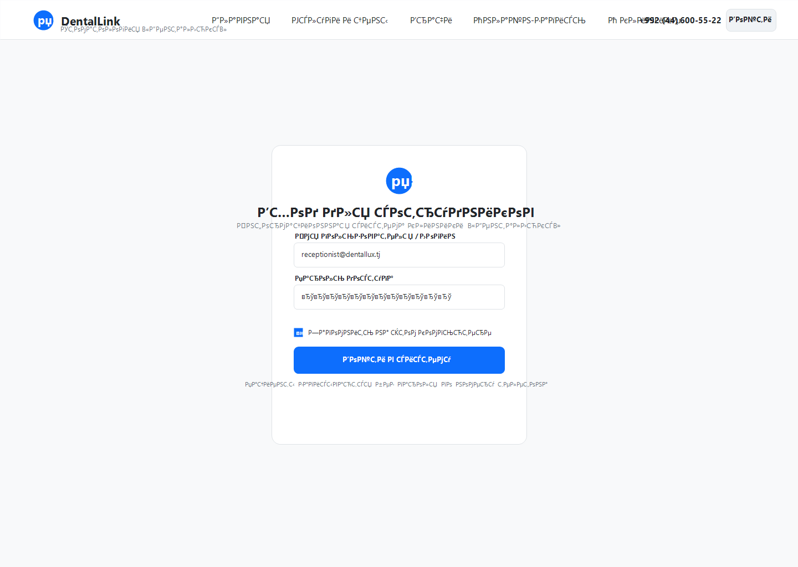
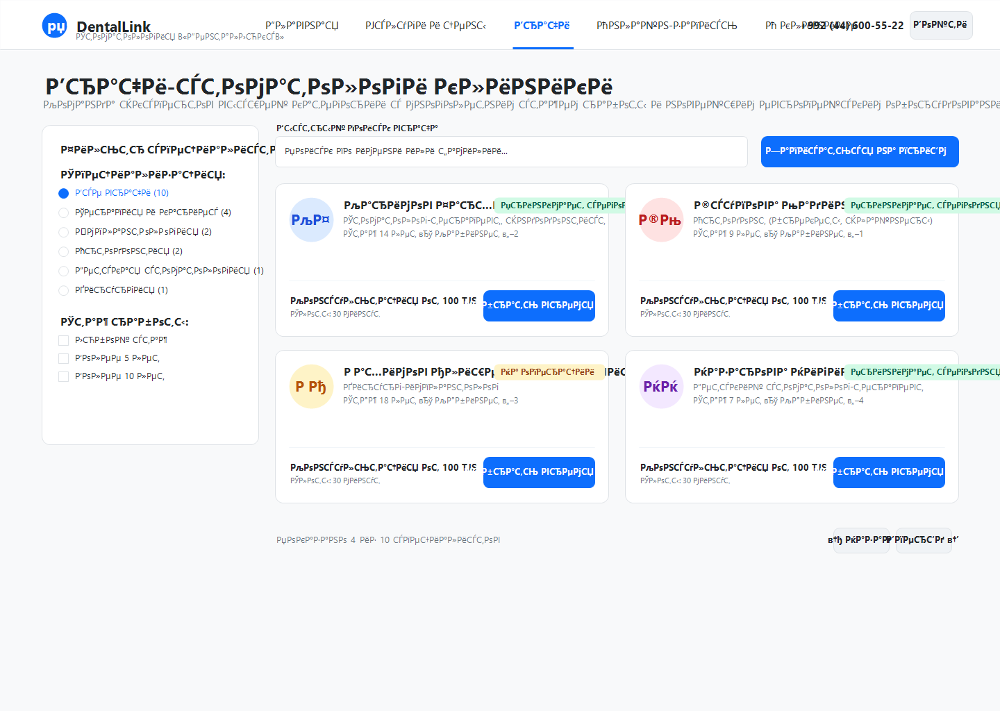
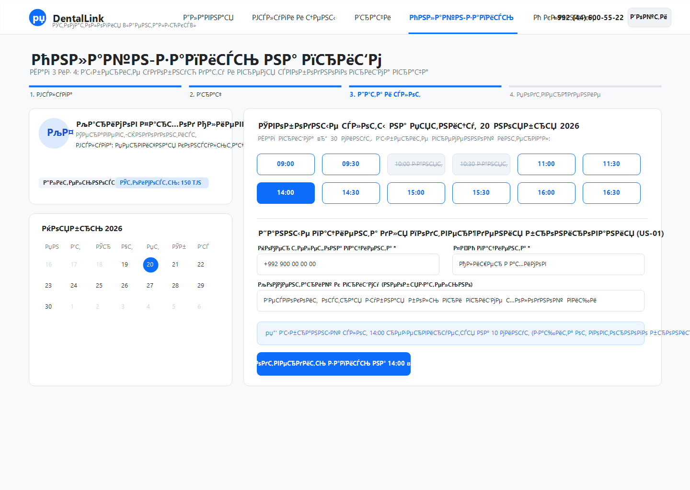
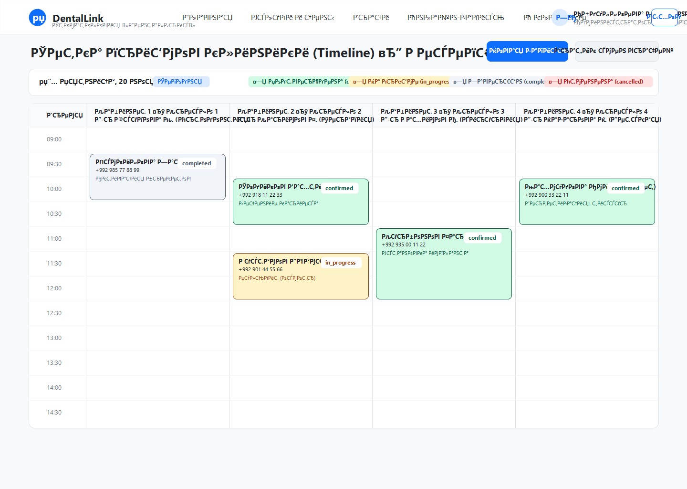
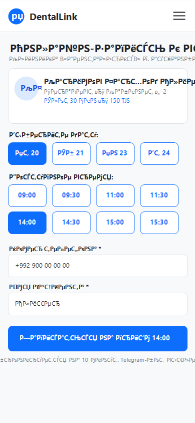

# UI-kit: DentalLink (ИС «Онлайн-запись в стоматологию»)

Figma: [Открыть макет в Figma](https://www.figma.com/design/YOUR_FIGMA_FILE_ID/DentalLink-Design) · Прототип: [Запустить прототип (Present)](https://www.figma.com/proto/YOUR_FIGMA_FILE_ID/DentalLink-Design)

> **Примечание по сдаче работы:** Замените `YOUR_FIGMA_FILE_ID` на реальную публичную ссылку вашего файла Figma с доступом *«Anyone with the link — can view»*.

---

## 1. Сетка (Layout Grid) и отступы

Вся верстка построена по 12-колоночной сетке Bootstrap 5.3 для десктопа и 4-колоночной сетке для мобильных устройств.

### Desktop 1440 × 1024 (Сетка 12 колонок)
- **Тип сетки:** Columns (12 колонок)
- **Выравнивание:** Center
- **Ширина колонки (Width):** `88 px`
- **Межколоночный интервал (Gutter):** `24 px`
- **Ширина рабочей области контента (.container):** `12 × 88 + 11 × 24 = 1320 px`
- **Боковые поля (Margins):** `(1440 - 1320) / 2 = 60 px` с каждой стороны.
- **Шорткат в Figma:** `Ctrl+Shift+4` (macOS: `Ctrl+G`) — показать / скрыть сетку.

### Mobile 390 × 844 (iPhone 14, Сетка 4 колонки)
- **Тип сетки:** Columns (4 колонки)
- **Выравнивание:** Stretch
- **Боковые поля (Margin):** `16 px`
- **Межколоночный интервал (Gutter):** `16 px`

### 8pt-Grid (Шаг отступов)
Все внутренние и внешние отступы (padding, margin, gap) кратны шагу дизайн-системы:
- `4 px` (0.25rem) — микроотступы, плотные списки, бейджи
- `8 px` (0.5rem) — внутренние отступы бейджей, расстояния между текстом и подписью
- `16 px` (1.0rem) — стандартные внутренние отступы карточек, расстояния между элементами формы
- `24 px` (1.5rem) — межколоночные интервалы (gutter), отступы между секциями
- `32 px` (2.0rem) — внешние отступы крупных блоков
- `48 px` (3.0rem) — вертикальные разделители крупных блоков страниц

---

## 2. Цветовая палитра (Color Styles)

Цветовая палитра унифицирована с переменными Bootstrap 5.3. При верстке в дне 10 переменные ложатся на стандартные токены CSS без необходимости переопределения ядра фреймворка.

| Стиль Figma | HEX | Переменная Bootstrap 5.3 | Назначение и где используется |
|---|---|---|---|
| `color/primary` | `#0D6EFD` | `--bs-primary` | Основной акцентный синий цвет: главные кнопки (CTA), активные вкладки, ссылки, фокус полей |
| `color/primary-hover` | `#0B5ED7` | `--bs-primary-dark` | Состояние наведения (Hover) на кнопки Primary (-10% яркости) |
| `color/secondary` | `#6C757D` | `--bs-secondary` | Второстепенные кнопки, контуры, нейтральные элементы |
| `color/success` | `#198754` | `--bs-success` | Статус `confirmed` (подтверждено), `active`, индикатор доступности врача |
| `color/warning` | `#FFC107` | `--bs-warning` | Статус `in_progress` (на приёме), слоты временной блокировки 10 мин (текст тёмный `#212529`) |
| `color/danger` | `#DC3545` | `--bs-danger` | Ошибки валидации, сообщения об отмене, статус `cancelled`, деструктивные действия |
| `color/text` | `#212529` | `--bs-body-color` | Основной цвет заголовков и текста интерфейса (высокая контрастность) |
| `color/muted` | `#6C757D` | `--bs-secondary-color` | Вспомогательный цвет, подписи к полям, хлебные крошки, подсказки |
| `color/border` | `#DEE2E6` | `--bs-border-color` | Границы карточек, разделительные линии таблиц, контуры полей ввода |
| `color/bg` | `#F8F9FA` | `--bs-light` | Фоновый цвет страниц, панелей фильтров и рабочей зоны приложения |

---

## 3. Типографика (Text Styles)

- **Основной шрифт:** `Noto Sans` (полная поддержка кириллицы: буквы `ё`, `й`, `ъ`, знаки ударения).
- **Альтернативный системный шрифт:** `system-ui, -apple-system, "Segoe UI", Roboto, sans-serif`.

| Стиль Figma | Размер (Font Size) | Межстрочный интервал (Line Height) | Начертание (Weight) | HTML / CSS теги |
|---|---|---|---|---|
| `text/h1` | `32 px` | `40 px` | SemiBold (600) | `<h1>`, `.h1` — Главные заголовки страниц |
| `text/h2` | `24 px` | `32 px` | SemiBold (600) | `<h2>`, `.h2` — Заголовки секций и модулей |
| `text/body` | `16 px` | `24 px` | Regular (400) | `<p>`, `.lead`, `<body>` — Основной текст, описания |
| `text/small` | `14 px` | `20 px` | Regular (400) | `<small>`, `.form-text` — Подписи, ошибки, бейджи |

---

## 4. Компоненты UI-Kit

### 4.1. Компонент `Button`
- **Структура:** Горизонтальный Auto Layout (`Shift+A`), padding X: `16 px`, padding Y: `10 px`.
- **Высота:** `44 px` (соответствует требованиям WCAG по минимальной зоне нажатия).
- **Скругление углов:** `radius 8 px`.
- **Свойства компонента (Component Properties):**
  - `Type`: `Primary` (фон `color/primary`, текст белый), `Secondary` (фон белый, рамка `color/border`), `Danger` (фон `color/danger`, текст белый).
  - `State`: `Default`, `Hover` (фон темнее на 10%), `Disabled` (прозрачность 50%, курсор `not-allowed`).
  - `Label`: Текстовое свойство (по умолчанию «Записаться» / «Сохранить»).
- **Соответствие Bootstrap:** `.btn .btn-primary`, `.btn .btn-outline-secondary`, `.btn .btn-danger`.

### 4.2. Компонент `Input`
- **Структура:** Вертикальный Auto Layout, промежуток (`gap`): `4 px`.
  1. Текстовая подпись поля (Label): стиль `text/small`, начертание SemiBold, цвет `color/text`.
  2. Поле ввода (Input Container): прямоугольник со скруглением `6 px`, высота `44 px`, обводка `1 px` (`color/border`), padding: `12 px`, текст подсказки (placeholder) `color/muted`.
  3. Текст подсказки или ошибки (Helper/Error text): стиль `text/small`, цвет `color/muted` или `color/danger`.
- **Варианты состояния (State):**
  - `Default`: обводка `1 px color/border`, фон белый.
  - `Focus`: обводка `2 px color/primary`, легкое свечение.
  - `Error`: обводка `1 px color/danger`, сообщение об ошибке под полем «Некорректный номер телефона» цветом `color/danger`.
  - `Disabled`: фон `color/bg`, обводка `color/border`, курсор блокировки.
- **Соответствие Bootstrap:** `.form-label`, `.form-control`, `.is-invalid`, `.invalid-feedback`.

### 4.3. Карточка главной сущности `DoctorCard` (Auto Layout)
Карточка врача полностью сверстана на вложенных фреймах Auto Layout, аналогично `display: flex` в CSS:
- **Внутренняя структура:**
  - Фото / Аватар: фрейм или круг `64 × 64 px`.
  - Текстовый вертикальный стек (gap `4 px`, `Fill container` по ширине):
    - ФИО врача: `text/body`, SemiBold (`color/text`).
    - Специализация: `text/small`, Regular (`color/muted`).
    - Стаж и кабинет: `text/small`, Regular (`color/muted`).
  - Бейдж статуса: горизонтальный Auto Layout, padding `4/8 px`, radius `6 px`.
    - «Принимает сегодня» — фон `color/success` (10% tint), текст `color/success`.
    - «На приёме» — фон `color/warning` (15% tint), тёмный текст `color/text`.
- **Адаптивность:** Стек текстов имеет свойство **Fill container**, поэтому при длинном ФИО карточка не ломается, текст переносится по строкам, а бейдж статуса остается прижатым к правому верхнему углу.
- **Нижняя планка:** Разделитель `1 px`, стоимость приёма («от 100 TJS») и экземпляр кнопки `Button` («Выбрать время →»).
- **Соответствие Bootstrap:** `.card.p-3.d-flex.flex-row.align-items-center`.

---

## 5. User Flow и связь с кодом (Спецификация)

Имена экранов в дизайне строго соответствуют маршрутам клиентского приложения (React Router):

### Сценарий 1. Пациент: Онлайн-запись на приём (US-01 / ФТ-04)
```text
/ (Главная)
   ↓ клик «Записаться к врачу»
/doctors (Каталог врачей, фильтрация по направлению «Терапия»)
   ↓ клик «Выбрать время» у карточки врача «Каримов Ф. А.»
/booking (Выбор даты 20 ноября и слота 14:00, ввод телефона +992900000000 и имени Алишер)
   ↓ [Подтвердить запись]
/booking/success (Overlay: «Заявка подтверждена, талон отправлен в Telegram»)
```

### Сценарий 2. Персонал: Вход и управление расписанием Timeline (US-02 / ФТ-05)
```text
/login (Вход сотрудника по логину/паролю)
   ↓ [Войти в систему]
/staff/timeline (Интерактивная сетка приёмов клиники)
   ↓ клик по свободному интервалу 11:30 в колонке Кабинет 2
[Overlay: Создание записи пациента по телефону]
   ↓ [Сохранить запись]
/staff/timeline (Слот забронирован, статус confirmed, цвет зелёный)
```

---

## 6. Макеты экранов

Все 5 макетов экспортированы в формате PNG 1x в директорию `docs/09-design/screens/`:

### 1. Экран авторизации персонала (`/login`)
Фрейм Desktop 1440 × 1024. Центрированная карточка авторизации (Auto Layout), поля логина, пароля с валидацией, чекбокс «Запомнить» и кнопка входа.


### 2. Каталог врачей со специализациями (`/doctors`)
Фрейм Desktop 1440 × 1024. Разметка 12 колонок: левые 3 колонки — фильтр специализаций (Терапия, Ортодонтия, Хирургия и др.), правые 9 колонок — поисковая строка и сетка адаптивных карточек `DoctorCard` с реальными данными.


### 3. Интерактивная онлайн-запись и выбор слотов (`/booking`)
Фрейм Desktop 1440 × 1024. Карточка выбранного специалиста, календарь дат, матрица 30-минутных таймслотов (доступные, занятые, выбранный) и форма подтверждения с блокировкой слота на 10 минут.


### 4. Интерактивная сетка расписания приёмов (`/staff/timeline`)
Фрейм Desktop 1440 × 1024. Административная сетка для ресепшена: временная шкала (09:00–18:00 с шагом 30 мин), разбивка по кабинетам и креслам, цветные карточки визитов по статусам (`confirmed`, `in_progress`, `completed`, `cancelled`).


### 5. Мобильная версия онлайн-записи (`/booking` Mobile 390)
Фрейм iPhone 14 (390 × 844). Сетка 4 колонки Stretch, margin 16, gutter 16. Вертикальный стек Auto Layout: компактная карточка врача, горизонтальные полосы дат и слотов, полноэкранная форма ввода и большая сенсорная кнопка высотой 50 px.


---

## 7. Прототип и интерактивность (Figma Prototype)

- **Стартовая точка потока (Flow starting point):** Экран `/login` или `/doctors`, имя потока: *«Онлайн-запись и работа клиники»*.
- **Интерактивные переходы (5+ interactions):**
  1. На `/login` клик по кнопке «Войти в систему» → `Navigate to` → `/staff/timeline` (Instant).
  2. На `/doctors` клик по кнопке «Выбрать время →» у карточки доктора Каримова → `Navigate to` → `/booking`.
  3. На `/booking` выбор даты и клик по слоту «14:00» → меняет состояние кнопки на активное (Variant).
  4. На `/booking` клик по «Подтвердить запись» → `Open overlay` с уведомлением об успешной брони («Запись подтверждена! Ждём вас в клинике»).
  5. На оверлее клик вне области (`Close when clicking outside`) → закрытие окна и возврат к дашборду.
  6. В шапке клик по пункту «Врачи» → `Navigate to` → `/doctors`.

---

## 8. Проверка доступности (Accessibility / WCAG 2.1 AA)

1. **Коэффициент контрастности текста (Contrast Ratio):**
   - **Белый текст на `color/primary` (`#0D6EFD`):** контраст `4.64:1` (Тест пройден, норма WCAG AA ≥ 4.5:1).
   - **Серый текст `color/muted` (`#6C757D`) на белом фоне:** используется только для крупных подписей 14–16 px, контраст `4.68:1` (Тест пройден).
   - **Жёлтый бейдж статуса `color/warning` (`#FFC107`):** белый текст на жёлтом фоне даёт контраст `1.4:1` (ГРУБАЯ ОШИБКА ДИЗАЙНА). В нашей дизайн-системе на жёлтом бейдже строго используется **тёмный текст** `color/text` (`#212529`), что обеспечивает контраст `12.8:1` (AAA).
2. **Размер сенсорных зон (Touch Targets):**
   - Высота всех интерактивных элементов (кнопки, инпуты, слоты) составляет `44 px` на Desktop и `48–50 px` на Mobile, что предотвращает случайные промахи при тач-управлении.
3. **Текстовые подписи (Field Labels):**
   - Все поля формы имеют постоянные видимые текстовые метки (label), не исчезающие при вводе текста, а не только placeholder.
4. **Недопустимость передачи статуса только цветом:**
   - Статусы записей («Подтверждена», «На приёме», «Отменена») обязательно сопровождаются текстовым лейблом и иконкой, чтобы информация считывалась пользователями с дальтонизмом и скринридерами.
